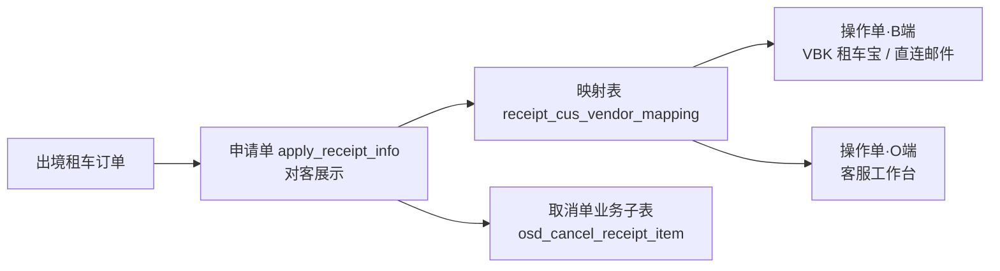
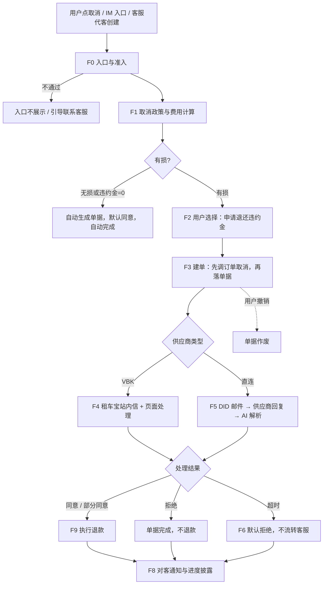

# 国际取消单（出境）— 业务流程与功能点

> 覆盖范围：单据平台「国际取消单」业务类型（`OSD_CANCEL_RECEIPT = 8`）。
> 组织方式：按用户/供应商/客服实际经历的顺序，一个功能点一段，含规则、失败处理与实现落点。
> 资料来源：飞书「6.国际取消单」目录下 5 篇核心技术文档 + 本地 `car-customer-operation-receipt-service` 代码。
> 标「待确认」的是文档之间、或文档与代码之间口径不一致处。

---

# 第一部分 项目背景与定位

## 1.1 为什么做

订单取消是出境业务 **Top4 客诉类型（占比 6.46%）**，在 Trip 站更是 **Top3（占比 22.99%）**。

原来的流程：用户在 App 看到"取消要扣违约金"，想申诉只能打电话 → 客服联系海外供应商（语言不通、时差大）→ 邮件来回 → 人工判断是否退 → 回复用户。全程用户看不见进度，于是反复进线。

## 1.2 项目目标

| 指标 | 目标 |
|---|---|
| 出境 CPO benchmark | 50% |
| 取消单占 CPO 比例 | 6% |
| 单据覆盖率 | 4% |
| CPO 降低绝对值 | CO 站 1%，T 站 0.8% |

一句话定位：**让客人可以自助提交「申请退还取消违约金」，由供应商线上回复同意/拒绝，客服兜底，全程进度可视。**

## 1.3 需求范围

- 渠道：CO、T 站、去哪儿的 App 与 H5；T 站 PC
- 订单：**预付订单**（预付全额、预付订金；不含预付保险）
- 供应商：VBK（租车宝）+ 直连（邮件）

## 1.4 与相邻业务的核心差异

这三条是理解整个项目的钥匙：

| 差异点 | 国际取消单 | 对比对象 |
|---|---|---|
| 供应商超时未回复 | **默认拒绝**退违约金，**不流转客服** | 国际费用单：超时流转客服处理 |
| 直连供应商接入 | 通过 DID 邮箱发信，供应商回邮件 → AI 解析 → 回写单据 | 国内取消单：无直连邮件链路 |
| 客服主动创建 | 支持客服在 O 端代客创建取消单 | 国际咨询单：以客人发起为主 |

---

# 第二部分 核心概念

## 2.1 两层单据 + 业务子表

复用费用单据已有架构，没有新建单据框架：



| 名词 | 含义 |
|---|---|
| 申请单服务 | 对用户端客人的操作做抽象，统一承接 |
| 操作单服务 | 对申请单的具体操作做抽象，统一承接 |
| 客服工作台 | O 端，客服操作 |
| 供应商后台 | B 端，VBK 租车宝页面 / 直连 API 与邮件 |
| 诉点（投诉点） | 单据挂载的问题分类，决定处理人、超时时长、单据类型 |

## 2.2 有损 / 无损：整个项目的分水岭

| 类型 | 含义 | 处理方式 |
|---|---|---|
| **无损取消** | 在免费取消期内，或违约金为 0 | 自动生成单据，**默认商家同意**，自动流转完成 |
| **有损取消** | 已过免费取消时间，会扣违约金 | 弹浮层让用户二选一：①申请退还违约金（走单据） ②接受扣款直接取消 |

派生出两种单据语义（联调文档里专门澄清过）：

- **有损转无损**：用户申请退还违约金 → 单据标题是「申请原因」
- **有损但未转无损 / 免费取消**：用户直接取消 → 单据标题是「取消原因」

## 2.3 单据状态机

| 操作 | 单据状态 | 用户侧看到 | 商家端 | 客服端 |
|---|---|---|---|---|
| 客人提交 | 未分配 | 已提交申请 | / | / |
| 单据被分配 | 已分配未处理 | 门店处理中 | 待处理 | 待处理 |
| 处理中 | 处理中 | 门店处理中 | 处理中 | 处理中 |
| 处理完成（同意） | 已完成 | 门店已同意 | 已完成 | 已完成 |
| 处理完成（拒绝） | 已拒绝 | 门店已拒绝 | 已完成 | 已完成 |
| 用户撤销 | 已取消 | 已撤回申请 | 已取消 | 已撤销 |

业务子表另有审核态 `order_refund_status`：`0 审核中 / 1 拒绝退还 / 2 同意退还 / 3 部分退还 / 4 取消`。

## 2.4 单据类型编码（待确认）

| 来源 | 取值 |
|---|---|
| 技术方案、商家端方案、本地代码 `ReceiptServiceTypeEnum` | **8（OSD_CANCEL_RECEIPT）** |
| 直连邮件方案正文与差异对照表 | 多处写 `CANCEL_RECEIPT(2)`，架构图里又写 8 |
| Shark Key 配置表 | 只列到 7（出境费用单据），**没有 8 的条目** |

**这是真实的文档冲突**，且直接影响邮件链路的门控是否命中。以代码为准应为 8，但需与邮件 job 负责人确认实际门控值。

---

# 第三部分 端到端流程



---

# 第四部分 功能点详解

## F0 入口与准入

**一句话**：判断这个订单此刻能不能发起取消单，并决定走哪条路。

### 判定维度

| 维度 | 判定内容 | 归属 |
|---|---|---|
| 订单状态 | 是否允许创建单据；是否预付订单 | 订单服务 |
| 有损判断 | 当前时间是否已过免费取消时间点 | 订单服务（取消政策） |
| AB 实验 | 按 UID 分流，对照组不展示入口 | 前端/实验平台 |
| 供应商灰度 | 按 `vendorId` 维度配置（VBK + 直连） | Qconfig |
| 是否已有在途单据 | 已有则走「再次申请」而非新建 | 单据服务 |
| 申请次数 | 最多 2 次 | 单据服务 |

### 代码侧的两道校验

建单入口先做两件事，顺序很关键：

1. `checkExistingReceipt(request)` —— 是否已有单据（用于识别"再次申请"）
2. `checkCancelOrderEligibility(orderDetail)` —— 订单是否满足取消条件

**两者都不满足才拒绝**（`!checkOrder && !hasExistingReceipt`）——这个写法是为了让"再次申请"能绕过订单侧的取消资格校验，因为订单此时已经处于取消流程中了。

### IM 入口

IM 会话里命中"取消订单"意图时，透出取消单入口，点击跳转提交页；单据创建后在 IM 展示服务进度卡片。

**实现落点**：`OsdCancelReceiptCreateStrategy.handle()` 前置校验；AB 与灰度在前端与 Qconfig。

---

## F1 取消政策与费用计算

**一句话**：告诉用户"现在取消要扣多少钱、能不能申请退"。

### 接口

`/cancelReceiptPolicy`，返回：

| 字段 | 含义 |
|---|---|
| `isLoss` | 是否有损 |
| `cancelTextInfoList` | 取消政策文案列表 |
| `isRemind` | 是否快到 15 分钟（临界提醒） |
| `cancelText` | 取消文案 |

### 展示内容

- 当前取消政策：免费取消 / 本单违约金 100%（CNY xx）
- 违约金总额 `penaltyAmount`
- 可申请退还金额 `applyAmount`
- 剩余退款金额与预计到账时间（1–5 个工作日）
- 先用后付订单特殊文案：退还的违约金从授权账户解冻

### 币种

有两个币种概念，容易混：

| 字段 | 含义 | 来源 |
|---|---|---|
| `cus_currency` | 客人支付币种 | 请求参数 `amountCurrency` |
| `settlement_currency` | 结算币种 | 订单属性 `settlementToCenterCurrencyCode`，取不到则回退 `localCurrencyCode` |

商家端详情还会展示结算金额（`penaltSettlementAmount` / `applyRefundSettlementAmount`），因为供应商关心的是自己的结算币种。

---

## F2 创建申请单

**一句话**：把用户的申诉固化成一张可追溯的单据。

### 接口

`/applyReceiptCreate`，核心入参 `OsdCancelInfo`：

| 字段 | 含义 |
|---|---|
| `orderLossy` | 无损 0 / 有损 1 |
| `penaltyAmount` | 总违约金 |
| `applyAmount` | 申请退款金额 |
| `amountCurrency` | 币种 |
| `payLater` | 是否先用后付 |
| `cancelReason` | 取消原因（一级+二级） |
| `cancelDesc` | 用户手动输入的原因描述 |

### 用户要填什么

- 取消原因：两级选择 + 可手动输入
- 退还比例：100% / 80% 等（PRD 预留）
- 凭证图片：**仅有损转无损场景支持上传**
- 「仍需用车」反馈项

### 建单时序（重要）

```
1. 查订单详情
2. 校验：已有单据? 订单可取消?
3. 【若非再次申请】调订单服务 cancellingOrder 执行取消
   ├─ 带上 lossFee（违约金）、applyForRefundlossFee（申请退还）、cancelReceiptId
   ├─ O 端来源标记 Source.Offline
   └─ 失败 → 直接返回失败，不建单
4. 抢分布式锁（orderId + eventTypeId + createOsdCancelReceipt）
5. 查诉点映射
6. 落 osd_cancel_receipt_item（审核态置 0 审核中）
7. 建 O 端或 B 端操作单 + 写映射
8. 异步通知任务单
```

**注意**：订单取消动作发生在**加锁之前**。这意味着并发场景下订单侧可能被调用两次（详见技术难点文档）。

**实现落点**：`OsdCancelReceiptCreateStrategy`、`CarOrderCancelContextProxy.cancellingOrder`。

---

## F3 分流：VBK 还是直连

**一句话**：同一张单据，两套完全不同的触达方式。

| 供应商类型 | 通知方式 | 处理界面 | 回写方式 |
|---|---|---|---|
| VBK（租车宝） | 站内信 + App push | 租车宝「单据管理」页面 | 页面提交 → 接口回写 |
| 直连 | **DID 邮件** | 邮箱回信 | AI 解析邮件 → 回写 |

分流判据是订单的 `vendorType`：邮件 Consumer 门控里明确 **VBK 跳过不发邮件**。

**免费取消的特殊路径**：无损或违约金为 0 时，单据自动生成、默认商家同意、自动流转完成，不触达供应商（邮件侧也在 Consumer 门控住，避免噪音）。

---

## F4 VBK 供应商处理（B 端）

**一句话**：商家在租车宝看到待办，点同意或拒绝。

### 四个接口改动

| 接口 | 改动 |
|---|---|
| `getReceiptTypeDropdownList` | 下拉框新增「取消单」类型（`receiptServiceType=8`） |
| `vendorReceiptList` | 支持按取消单类型筛选，返回 `osdCancelReceipt` 对象 |
| `vendorReceiptDetailInfo` | 详情新增取消单字段（含结算币种与结算金额） |
| `vendorReceiptReply` | 回复接口接收 `approval` + `refuseContent` |

### 商家看到什么

- 列表：订单号、单据号、单据类型、发起时间、最晚处理时间、催办标识、超时标识
- 详情：产生违约金额、申请退还金额、单据内容（一级原因-二级原因-用户输入）、原文与译文、用户上传凭证
- 处理：同意 / 拒绝（拒绝必填原因）

### 超时的接口反馈

超时后商家再提交，接口直接返回：`"Query ticket has timed out and will be transferred to customer support"`。

---

## F5 直连供应商邮件链路

**一句话**：没有页面可用的海外供应商，用邮件当接口。

这是整个项目最复杂的部分，完整技术细节见技术难点文档，这里只讲业务流程。

### 发信：三类邮件

| 场景 | businessChannel | 触发时机 |
|---|---|---|
| 创建 | 1 | 单据创建（`opType=0`） |
| 催办 | 2 | 用户或客服催（`opType=1`） |
| 无效回复 | 3 | 供应商回了但 AI 判定无效（`opType=9999`） |

邮件内容包含：违约金总额、申请退还金额、币种、取消原因（一级+二级+用户输入）、用户上传附件。
处理时限（`agreedTime`）：创建场景按诉点配置的 `vendorReplyTimeout` 计算；催办场景取申请单 `callTime` 距今剩余小时。

### 收信：AI 解析供应商回复

供应商回邮件 → DID 系统投递到独立 topic → AI 解析出结构化结果：

| AI 字段 | 取值 |
|---|---|
| `cancelReplyType` | AGREE_FULL / AGREE_PART / REJECT / UNCLEAR |
| `refundAmount` | 同意场景的退还金额 |
| `rejectReason` | 拒绝理由（翻译为中文） |
| `replyOriginContent` | 原文摘要 |

解析结果回写到 B 端操作单，等价于"供应商在页面上点了同意/拒绝"。

### 对客转发

解析完成后触发转发邮件给用户。

---

## F6 超时默认拒绝

**一句话**：供应商不回复，就当他拒绝。

### 业务规则

- 供应商超过配置时长（诉点配置 `vendorReplyTimeout`，示例值 2880 分钟 = 48 小时）未处理 → **自动拒绝**
- **不流转客服**（这是与国际费用单最大的区别）
- 对客用固定文案回复
- 拒绝原因码 `reject_code`：`0 默认拒绝 / 1 超时拒绝`

### 为什么不流转客服

费用单超时流转客服，是因为费用争议需要人工核账；取消单的结论是二元的（退/不退违约金），供应商不表态就按合同条款执行（不退），客服介入也改变不了合同，反而增加客服工作量。

### 实现现状（待确认 / 风险）

| 环节 | 现状 |
|---|---|
| 发送超时延时消息 | ✅ 已实现（建单时按单据类型发送） |
| 消费超时消息并自动拒绝 | ❌ **超时消费者里没有国际取消单分支**（只有国内费用单、国际费用单、修改单） |

也就是说在本仓库里，取消单的超时消息发出去了但没人消费。邮件方案文档声称"此默认拒绝由操作单侧通过 callTime 触发"，需确认是在另一个应用实现，还是确实缺失。**这是上线前必须确认的一条**。

---

## F7 客服处理（O 端）

**一句话**：客服是这条链路的兜底与代办者。

| 功能 | 说明 |
|---|---|
| 代客创建 | 客服在 O 端主动创建取消单（国内取消单没有这个能力） |
| 单据列表 | 区分「客服处理」和「供应商处理」两个 TAB |
| 单据详情 | 展示违约金额、申请退还金额、审核态、取消原因、操作人 |
| 流转供应商 | `/transform`，`type=3` 为新增的「流转供应商」；**只有取消单诉点才出现这个按钮** |
| 接管 | `/takeOver`，超时或主动接管，需绑定录音/会话 ID |
| 处理完成 | `/completeReceipt`，携带 `OsdCancelReceiptReviewResult` |
| 查看供应商进度 | 展示供应商处理记录与回复 |

### 客服完成单据的结果字段

```
reviewResult     1 拒绝退还 / 2 同意退还 / 3 部分退还
opRefundAmount   操作退还金额
rejectReason     拒绝原因
```

对客回复弹窗会根据选择变化：拒绝要填原因；部分退款要填金额（展示本订单最多可退金额）。

**实现落点**：`OsdCancelReceiptCompleteExtension`、`OsdCancelTakeOverStrategy`、`OsdCancelReceiptCancelBizProcessStrategy`、`VendorOsdCancelReceiptCompleteService`。

---

## F8 用户侧功能（C 端 + IM）

**一句话**：让用户不用打电话就知道进度。

| # | 功能 | 规则 |
|---|---|---|
| 1 | 发起单据 | 订详 + IM 两个入口，IM 支持 AI 意图识别 |
| 2 | 服务轨迹 | 最长轨迹：已提交 → 门店处理中 → 客服处理中 → 处理完成；展示预计完成时间 |
| 3 | 催单据 | **提交 + 5 小时后**才可点击；之前点击 toast 提示；最多催 **1 次**；催后按钮置灰 |
| 4 | 撤销单据 | 完成前可撤销，最多 2 次 |
| 5 | 再次申请 | 被拒绝或主动撤销后 **24 小时内**可再次申请，总共最多 2 次 |
| 6 | 结果通知 | 短信 + App push；直连供应商场景转发回复邮件 |
| 7 | 单据列表 | TAB 区分「处理中」与「历史申请」 |
| 8 | 单据详情 | 大状态、处理结果、对客提示、进度时间线、金额、原因、凭证、操作按钮 |
| 9 | IM 服务卡片 | 展示进度卡片，点击跳详情 |

### 接口清单

`/applyReceiptCreate`、`/applyReceiptCancel`、`/applyReceiptRemind`、`/applyReceiptList`、`/applyReceiptDetail`。

列表与详情返回的 `cancelReceipt` 结构包含：`payLater`、`orderLossy`、`cancelReason`、`cancelDesc`、`cancelAndRejectCount`、`inProcess`、`finishCount`、`penaltyAmount`。

### IVR + ASR

与国内一致：无损直接取消并走单据；有损引导用户到 App 端操作，由运营配置。

---

## F9 退款执行与结算

**一句话**：单据结论要变成真实的钱。

### 退款动作

客服/供应商处理完成后，调订单服务 `auditRefundLossFee`：

| 参数 | 说明 |
|---|---|
| `orderId` | 订单号 |
| `auditResult` | 审核结果（撤销场景传 3） |
| `operator` | 操作人 |
| `source` | 来源 |

### 先用后付

先用后付订单不是真的退钱，而是**从授权账户解冻**对应金额，对客文案要区分。

### 结算（待确认）

技术设计文档明确列为风险项：**发起取消单时先不结算，还是结算后对冲？** 以及"第二次发起的结算时间"。这两个问题文档里都还是「待确认」状态。

---

# 第五部分 数据模型

## 5.1 业务子表 `osd_cancel_receipt_item`

| 字段 | 类型 | 说明 |
|---|---|---|
| `apply_receipt_id` | bigint | 申请单 ID |
| `order_id` | bigint | 订单 ID |
| `receipt_service_type` | int | 单据业务类型 |
| `receipt_type` / `sub_receipt_type` | int | 诉点类型 / 单据子类型 |
| `order_lossy` | tinyint | 无损 0 / 有损 1 |
| `penalty_amount` | decimal(15,2) | 总违约金 |
| `apply_amount` | decimal(15,2) | 申请退款金额 |
| `order_refund_status` | tinyint | 0 审核中 / 1 拒绝 / 2 同意 / 3 部分 / 4 取消 |
| `op_refund_amount` | decimal(10,2) | 客服/供应商实际退还金额 |
| `cus_currency` | varchar | 客人币种 |
| `cancel_reason` / `cancel_desc` | varchar(5000) | 取消原因 / 原因描述 |
| `reject_code` | int | 0 默认拒绝 / 1 超时拒绝 |
| `pay_later` | tinyint | 是否先用后付 |
| `operator` / `operator_type` | varchar / int | 操作人 / 0 客服 1 供应商 2 客人 |
| `biz_id` / `biz_type` | bigint | 内部业务标识 |
| `is_valid` | tinyint | 1 有效 / 0 作废 |
| `userdata_location` | varchar | 出海数据区域标识 |

索引：`idx_order_id_valid`、`idx_receipt_id_valid`、`ix_datachange_lasttime`。

代码里还看到 DDL 未列出的字段：`settlement_currency`、`reject_reason`、`reject_reason_trans`、`trans_reply_content`、`locale`——说明实际表结构比文档 DDL 更新（**文档 DDL 已过期**）。

## 5.2 诉点配置

| 字段 | 说明 |
|---|---|
| `id` | 单据类型 ID |
| `nameOfShark` | 单据类型名称的 Shark key |
| `vendorReplayTimeout` | 供应商超时回复时间（分钟） |
| `handler` | 处理人：1 客服 / 2 供应商 |
| `enableFlag` | 是否可用 |
| `receiptComplaintPointId` | O 端单据类型 ID |
| `receiptType` | 1 咨询单 / 2 取消单 |

本次新增 2～3 个诉点（出境、Trip），O 端由 Trip 客服创建，指派给南通客服组。

---

# 第六部分 服务边界

| 能力 | 归属 |
|---|---|
| 取消政策、违约金计算、订单取消执行、退款（`auditRefundLossFee`） | 订单服务 |
| 申请单生命周期、对客列表/详情/催办/撤销 | 申请单服务 |
| 操作单生命周期、流转、接管、完成、超时 | 操作单服务（本仓库） |
| VBK 页面与接口 | 租车宝 |
| DID 邮件发信/收信、AI 解析 | 邮件 job（appId 100013573） |
| AB 实验与入口展示 | 前端 |

---

# 第七部分 灰度与发布

## 7.1 灰度策略

| 维度 | 方式 |
|---|---|
| 前端 | AB 实验按 UID 分流，对照组不展示入口 |
| 后端 | Qconfig 按 `vendorId` + 单据类型控制 |
| 邮件 | `merchantBusinessCreateConfigV2.json` 按 vendorIds 白名单，初期仅 1–2 家直连供应商；另有开关 `osd.cancel.email.send.enable`（默认关），按 `orderId % 100` 分批 |

**放量节奏**：1–3 天内部 → 3–5 天 10% → 5–7 天 50% → 7 天后全量。

## 7.2 发布顺序

订单服务 → 申请单服务 → 操作单服务 → 前端。

## 7.3 降级方案

| 故障 | 降级动作 |
|---|---|
| AB 实验关闭 | 对照组不展示取消单入口，回到原流程 |
| 供应商灰度关闭 | 取消单不流转至商家 |
| DID 邮件异常 | 降级为客服手动处理 |
| 邮件发信异常 | 关 Qconfig 开关，发信立即停止；收信独立 topic，不影响存量费用单/咨询单 |

---

# 第八部分 已知风险与待确认

## 8.1 文档自带的风险项

| 风险 | 说明 |
|---|---|
| 结算方案未确认 | 发起取消单时先不结算 vs 结算后对冲 |
| AI 翻译/解析准确性 | 供应商邮件 AI 总结准确性需验证，上线后至少 2 周人工抽检，错误率 >5% 告警 |
| 超时自动拒绝逻辑 | 需确保时机判断准确 |
| VBK 与直连边界 | 依赖 `OrderDetail.vendorType` 稳定可靠，上线前抽 100 单静态对账 |
| 多语言 | 非英语供应商（西/法/意）回复样本需校验 |

## 8.2 待确认问题（文档原文）

| 问题 | 跟进人 |
|---|---|
| 结算方案 | 宋道国、Max |
| 有损取消时客服是否能发起 | Max、于淼 |
| 第二次发起的结算时间 | 李军 |
| IM 中文案确认 | 于淼 |
| 租车宝 push code | Max |

## 8.3 本次对照代码新发现的问题

| # | 问题 | 影响 |
|---|---|---|
| 1 | **超时消费者无取消单分支**：建单时发了超时延时消息，但消费端只处理国内费用单/国际费用单/修改单 | 「超时默认拒绝」可能完全未生效，单据会一直挂着 |
| 2 | **`receiptServiceType` 口径冲突**：代码与多数文档是 8，邮件方案多处写 2，Shark 表无 8 的条目 | 邮件链路门控可能不命中，直连供应商收不到邮件 |
| 3 | **文档 DDL 已过期**：实际表有 `settlement_currency`、`reject_reason_trans`、`locale` 等字段，DDL 里没有；DDL 里 `idx_receipt_id_valid` 引用的 `receipt_id` 列在字段定义里也不存在 | 按文档建表会失败 |
| 4 | **订单取消在加锁之前执行** | 并发请求可能重复调用订单取消接口 |
| 5 | 联调遗留：`curProcessStatusSubDesc` 文案拼接出现 `"null有更低价;携程降价"`；`cancelReceiptInfo` 缺 title/remark | 对客文案错误 |

---

# 第九部分 术语表

| 术语 | 含义 |
|---|---|
| 有损 / 无损取消 | 是否产生违约金 |
| 有损转无损 | 用户申请退还违约金并获批，等价于无损取消 |
| VBK | 租车宝，供应商自助平台 |
| 直连供应商 | 无平台账号、通过 API/邮件对接的海外供应商 |
| DID 邮箱 | 统一对商邮件通道 |
| 诉点 | 单据挂载的问题分类，决定处理人与超时时长 |
| 先用后付 | 授权扣款模式，退款表现为解冻额度 |
| CPO | 人工进线量，本项目核心指标 |
| CO / T 站 | 携程国内站 / Trip.com 国际站 |

---

# 附：本文档的资料覆盖范围

**已读（5 篇核心技术文档）**：
1. 单据化-国际取消单技术方案（主方案）
2. 国际取消单技术设计文档（v1.0，赵亮）
3. 国际取消单-直连供应商邮件 技术方案
4. 国际取消单-商家端技术方案
5. 国际取消单-联调问题

**已对照**：本地 `car-customer-operation-receipt-service` 仓库中 19 个 `OsdCancel*` 相关类。

**未读（判断为低技术价值或过程性文档）**：项目排期、工时、会议纪要、Shark 送审、前端增量文档、测试问题、测试记录、一期/二期/三期发布计划、邮件规则配置优化、IM 技术文档、发布依赖。如需覆盖三期范围或邮件规则配置细节，可补充阅读。
