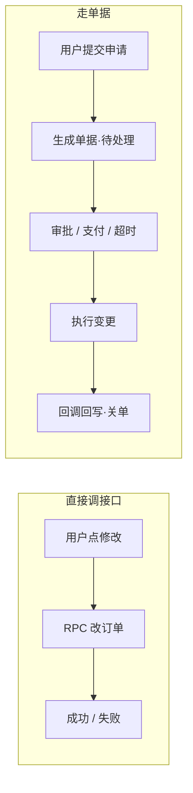
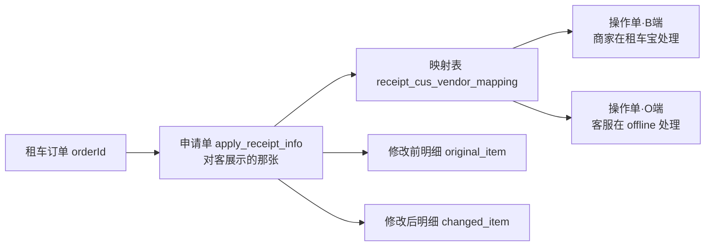
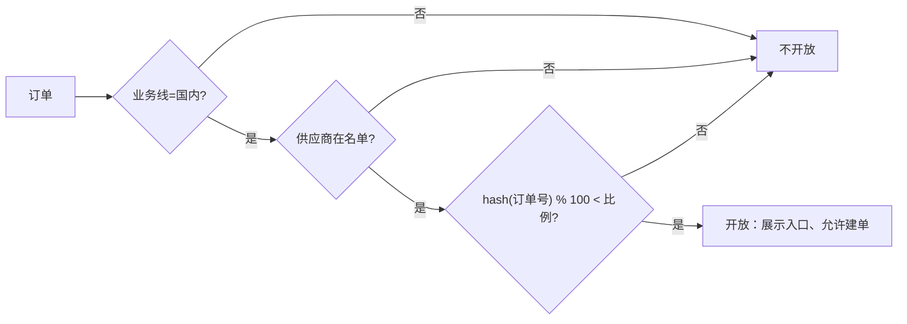
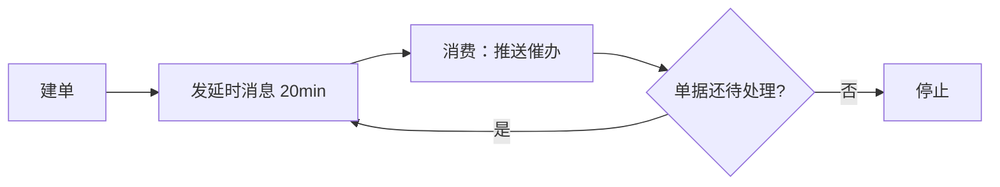

# 国内租车「修改单据化」— 业务流程详解（讲解版）

> 这份文档不是接口说明，而是按"一个人从头理解这个项目"的顺序写的：
> 先讲为什么要有单据，再按用户/客服/商家经历的顺序，一个功能点一个功能点往下讲。
> 每个功能点固定五段：**一句话定位 → 为什么需要 → 怎么运作 → 难点解释 → 失败与边界 → 实现落点**。
> 标「待确认」的是文档与代码口径不一致的地方，答辩或写材料前需要跟产品对齐。

---

# 第一部分 先把地基讲清楚

## 1.1 业务背景：这件事原来怎么干的

租车订单从下单到取还车之间，用户经常要变更：航班延误要改取车时间、临时换取车地点、更换驾驶员、续租几天、提前还车。

改造之前，这件事的路径是：用户打客服电话 → 客服记录 → 客服联系商家 → 商家线下在门店系统改 → 客服回电告知 → 费用线下收。

问题出在四个地方：

| 问题 | 具体表现 | 后果 |
|---|---|---|
| 没有审批边界 | 航班延误改时间是规则内的正常操作，也要打电话；而临近取车改时间本该商家同意，却常常一个电话就改掉了 | 用户体验差 + 商家权益无保障 |
| 没有时效 | 商家什么时候处理完全看心情，客服只能反复催 | 用户干等，二次三次进线 |
| 费用是糊涂账 | 续租、提前还车的补款退款线下收，事后容易扯皮 | 客诉、资损 |
| 用户看不见 | 用户不知道"我申请的改动办到哪了" | 反复询问，CPO 上升 |

所以这个项目的目标很直接：**把"改订单"从一次口头约定，变成一张有流程、有时效、有凭证的单据，让能自助的人自助，让必须审批的事有据可依。**

核心指标是 **CPO（人工进线量）**，也就是把原本要打电话才能办的事，搬到线上办掉。

## 1.2 为什么不能"直接调接口改订单"

这是整份文档最该先想明白的问题。很多人会问：不就是改个订单字段吗，写个接口不就行了？

先看两种做法的差别：

差别不在代码量，而在**中间有没有一个「可查询、可停留、可追责」的对象**。

直接改订单，会在下面这些地方卡死：

1. **商家不同意怎么办？** 接口只能返回 error，但业务上这不是失败，是「挂起，等商家在另一个系统里审」。没有单据，这个"挂起"只能塞进订单表的某个 flag，越塞越乱。
2. **用户要等 12 小时，这段时间订单是什么状态？** 订单还是原订单，但"有一件修改正在申请中"必须能被查到——否则用户再点修改、客服再建单、订单被取消，全部撞车。
3. **退款是异步的，失败了谁追？** 调资金接口失败只能重试，重试到什么时候、谁负责、要不要人工介入，这是流程问题，接口层没有位置放。
4. **同一件事，三种人要看三种视图**：用户关心"办到哪了"，商家关心"几点前必须审完"，客服关心"卡在哪、要不要我接管"。
5. **三个月后的客诉怎么还原？** 谁、什么时候、基于什么原因、把取车时间从几点改到几点、商家是否同意、收了多少补款。直接改数据只剩一行 update 的 binlog。
6. **订单被取消了，在途的修改怎么办？** 需要一个地方批量收口。
7. **重复提交、消息重复投递怎么办？** 有终态、有状态机，才有地方做幂等。

**一句话**：接口解决「一次调用」，单据解决「一件跨角色、耗时间、可能失败的事」。

## 1.3 单据化到底"化"掉了什么

四件事，缺一件都不值得单独建项目：

| 要素 | 含义 | 在本项目里 |
|---|---|---|
| 状态机 | 把一次动作拆成可停留的节点 | 未处理 → 客服处理中 → 商家处理中 → 用户待补款 → 已完成/已取消 |
| 待办 + SLA | 每个停留点有责任人和截止时间 | 场景化 deadline（1h/2h/12h/新还车时间）+ 超时自动处理 |
| 凭证 | 明细快照、附件、操作日志 | 修改前/后两张明细表 + 拍照留证 + 订单日志回写 |
| 账本 | 费用与结果的最终归属 | 补款/退款金额、支付方、以订单实际值覆盖预估值 |

**单据化 = 把「动作」变成「凭证」，让一次不可回滚的写操作，变成一段可观测、可干预、可审计的过程。**

## 1.4 反对意见：什么时候不该单据化

这条能说明设计不是"什么都上平台"：

- 同步、单方、无审批、无费用的小改动（改联系电话、改发票抬头）→ 直接调接口 + 一条操作日志就够；
- 毫秒级强实时操作（改密码、锁库存扣减）→ 加单据只会拖慢 RT；
- 纯后台数据订正 → 管理系统的编辑功能足够。

判断标准一句话：**这件事会不会在中间停下来等人？会，就值得单据；不会，就别上。**

代价也要认：表多（一个业务四五张表）、状态多（三套并存）、链路长（六个阶段）、一致性只能做到最终一致、商家和客服都要重新培训。

## 1.5 单据长什么样：两层单据 + 一张映射

这是最容易晕的地方，先把对象关系钉死：

- **申请单**：用户看到的那一张，`cus_receipt_id` 是它对外的身份。
- **操作单**：内部真正干活的那一张，商家一张、客服一张，靠映射表挂到同一张申请单上。
- **明细**：修改前后的两组快照，加审核态、金额、拒绝原因。

**为什么要拆两层？** 因为客、客服、商家是三方三个系统。用户只关心进度条，商家只关心待办和时限，客服关心单据卡在哪。同一件事三种视图，但内部必须是同一条处理链——所以一张脸，两张手。

**单据家族**：单据平台不止修改单，还有 2 取消单、6 国内费用单、8 国际取消单、**9 修改单**。修改单不是新系统，只是平台上的一个新业务类型，复用创建、流转、催办、接管、取消、附件、任务链、进度披露全部能力。

## 1.6 难点解释：为什么有三套状态

初学这个项目的人，最先被"状态"绕晕：同一张单，问"现在什么状态"，三个人能给出三个答案。

| 状态 | 存在哪 | 给谁看 | 典型取值 |
|---|---|---|---|
| 操作单主状态 | `operation_receipt.status` | 内部流转、任务链 | 未分配 / 已分配未处理 / 处理中 / 暂缓 / 已完成 / 挂起 / 已取消 |
| 申请单状态 + 子状态 | `apply_receipt_info` | 对客进度条 | 已提交、等待门店处理、客服介入、待支付、已支付、修改成功、修改失败、已撤销、超时未支付…（20 多个） |
| 明细 `display_status` | `modify_receipt_changed_item` | 修改单专用进度节点 | 0–21、22（修改中）、100（完成） |

**为什么会这样？** 因为三套状态服务三种诉求：

- 主状态是**流程引擎**用的：决定下一步该跑哪个任务（分配、处理、催办、完成）。
- 申请单状态是**给用户讲故事**用的：用户不需要知道"商家处理中"这种内部术语，需要知道"等待门店确认，审核通过后订单信息将修改成功"。
- 明细状态是**修改单自己的业务进度**：比如"待用户付款""用户已拍照留证"，这些在通用单据状态里没有对应物。

**排障铁律：看单据问题，先问"你看的是哪套状态"。** 三套之间靠代码同步，没有对账任务，这是长期风险（见第 16 章）。

---

# 第二部分 场景码：全项目的路由键

## 2.1 为什么需要"场景"这个概念

修改订单这件事，看起来只有一句"改一下"，实际上业务规则差异极大：

- 改取车时间，和改还车时间，介入的角色不同（一个在取车前，一个在用车中）；
- 续租时，有库存和无库存，能不能当场给结果完全不同；
- 同样是无库存，商家可能愿意"强制续租"，也可能直接拒；
- 无忧租延迟还车，还要看门店是不是营业时间。

这些差异如果都写成 if-else，代码会烂掉。所以抽象出一个**场景码 modifyScene**，它把"业务条件"压缩成一个整数，后面所有分支只看它。

**场景码 = 规则内外 × 库存 × 业务类型**，三个维度组合出 11 个场景。

## 2.2 场景总表

| 码 | 含义 | 自动生效 | 调哪个订单接口 | 商家最晚处理 |
|---|---|---|---|---|
| 1 | 修改订单（规则内） | ✅ | 修改订单 | 1h（兜底） |
| 2 | C 端履约变更（规则外·取车前） | ❌ | 行程变更 | min{提交+2h, 新取车时间} |
| 3 | 续租（规则内·有库存） | ✅ | 续租 | 1h（兜底） |
| 4 | 续租（规则内·无库存） | ❌ | 续租 | min{提交+12h, 还车时间} |
| 5 | 续租（规则外·无库存） | ❌ | 续租 | min{提交+12h, 还车时间} |
| 6 | 提前还车（规则内） | ✅ | 提前还车 | 1h（兜底） |
| 7 | 提前还车（规则外） | ❌ | 提前还车 | = 新还车时间 |
| 8 | 无忧租延迟还车（有库存·营业中） | ✅ | 续租 | 1h（兜底） |
| 9 | 无忧租延迟还车（无库存·营业中） | ❌ | 不调 | min{提交+12h, 还车时间} |
| 10 | 无忧租延迟还车（非营业时间） | ❌ | 不调 | min{提交+12h, 还车时间} |
| 11 | 续租（规则外·有库存） | ✅ | 续租 | 规则外 12h 口径 |

两条规律先记住：

1. **库存决定要不要人审**：有库存 → 系统能算价、能判断可售 → 自动生效。
2. **规则内外决定钱怎么算**：窗内按标准规则，窗外按规则外价格（可能更贵），但不额外增加审批。

## 2.3 难点解释：规则内外和库存，是两件不相干的事

这是全篇最容易混的一点。很多人下意识认为："规则外 = 需要审批"，于是看到"规则外有库存自动通过"就觉得是 bug。

**正确答案：这两个维度问的是不同的问题。**

| 维度 | 回答的问题 | 决定了什么 |
|---|---|---|
| 规则内 / 规则外 | 这笔修改的**费用归谁、按哪套价格算** | 用户承担多少、是否可能加收、走哪个价目 |
| 有库存 / 无库存 | 门店**到底能不能履约** | 系统能否当场给结论，还是必须问人 |

**审批的唯一目的，是获取"只有人才能提供的信息"**——能不能接、多少钱。有库存时，这两件事系统都知道，审批就变成了纯延迟。

为什么"有库存"足以替代商家点头？三条理由：

1. **履约可行性系统已知**：库存里有车 = 这个时段不会和下一单冲突 = 不需要调车、不需要额外排人力。商家拒绝的真实理由（车要保养、要调走）在库存系统里已经体现为不可售。
2. **价格不需要门店报价**：续租价是按门店维护的价格策略 + 日租金 × 天数算的，规则外只是换一套价格规则，系统自己算得出来。
3. **对商家有利**：续租是往用户身上加钱，不涉及退款扯皮。真正需要商家判断的是"退多少、要不要收"这类减少自己收入的动作（提前还车退款、履约变更退补款）。

再加一条现实因素：规则外往往意味着**临近取还车时间**。这时让商家审 2–12 小时，用户等不到结果就会打电话——正好是这个项目要消灭的 CPO。

**四象限记住了就再也不会绕：**

| | 有库存 | 无库存 |
|---|---|---|
| **规则内** | 场景 3，自动生效 | 场景 4，转商家 |
| **规则外** | 场景 11，自动生效 | 场景 5，转商家 |

**但要注意：自动通过 ≠ 和规则内一样。** 规则外仍有三处差异：价格更高（规则外价，可能含手续费）、失败兜底更重（库存被抢要回退客服）、撤销可能受限。

**这条设计也有代价（答辩时要能说出来）**：库存是系统快照，不等于门店真实意愿。车可能当天故障、门店可能计划保养但没关库存。这时自动通过就把"系统判断"当成了"门店承诺"，最后变成到店纠纷。缓解手段是失败回退客服、允许门店申诉，而不是靠审批来防——因为审批面对的是同一个信息差，只是把风险从"系统判断错"变成"商家懒得审"。

> 补充：场景 11 是代码里后加的枚举，技术文档的 modifyScene 只定义到 10。说明这是后续产品口径调整（"库存决定审批、规则内外决定价格"）补出来的，文档还没同步。

---

# 第三部分 按流程逐个讲功能点

## F0 准入判断

### 一句话定位

判断「这个订单、这一项修改、此刻、这个入口，允不允许」，并把结果收敛成一个场景码。

### 为什么需要

准入是整条链路的闸门。它不改数据，但**一次判定决定了后面 11 条分支**。没有准入，会出现：

- 已取消的订单也能发起修改；
- 门店取车的订单也能改地址；
- 灰度外的用户看到入口、点进去才发现不能用；
- 同一个进线事件下重复建单。

而且准入必须前置：等到用户填完表单、点提交才失败，体验最差，无效请求还会打到下游。

### 怎么运作：七层判定

顺序原则：**先本地后远程、先粗后细，任一环不通过立即短路**。否则每个请求都要打满全部下游接口。

| 层 | 判定什么 | 归属 | 不通过的结果 |
|---|---|---|---|
| ① 入口 | 按钮是否展示、是否可点 | 前端 + 订单状态 | 置灰 / 隐藏 |
| ② 身份 | 订单归属、客服/商家操作权限 | 各端 | 拒绝访问 |
| ③ 配置 | 进线事件 + 单据类型 + 供应商是否配了投诉点映射 | 单据服务 | 建单失败（原因码缺失） |
| ④ 订单 | 订单存在、非终态、业务线是否开放 | 订单服务 | 「订单不存在」/「不支持修改」 |
| ⑤ 规则 | 规则内外、时间窗、供应商能力 | 订单服务 | 只能协商 / 不支持 |
| ⑥ 字段 | 单项能否改、限制条件 | 订单服务 | 单项置灰 + 原因 |
| ⑦ 并发 | 是否已有在途单据、是否超次数 | 单据服务 | 二次确认 / 拒绝 |

### 难点解释一：时间窗到底怎么算

这是业务规则里最绕的一段，用三个时间点记：

- **规则内**：当前时间 < 商家允许自助修改的截止时间（原单修改截止时间）。
- **规则外**：截止时间之后，到 `min{预计还车时间，预计取车时间 + 5 小时}` 之间。这段时间内可以提交，但必须走「协商修改」，由商家审批。
- **超出上限**：晚于"预计取车时间 + 5 小时"，或者已经到了预计还车时间还没取车 → **直接不允许改**，只能联系门店。

为什么上限是"取车时间 + 5 小时"？因为超过这个点，用户基本已经到店或已取车，"提前改取车信息"这件事失去意义，应该走履约变更或门店现场处理。

### 难点解释二：功能灰度（业务线 / 供应商 / 比例）

「灰度」经常被说得很玄，其实一句话：**新功能不全量上线，而是按维度一批一批放量，出问题能立刻收回来。**

它和「功能开关」的区别：开关只有开/关两档，灰度是一条可以调的放量曲线（0% → 5% → 20% → 50% → 100%）。

三个维度各解决一类风险：

| 维度 | 解决的风险 | 怎么判 | 例子 |
|---|---|---|---|
| 业务线 | 能力边界不同 | 白名单 | 只开国内租车；国际/境外暂不开放，因为单据类型、供应商体系、规则全不一样 |
| 供应商 | 外部协作方是否就绪 | 供应商名单或类型 | 修改单要商家在租车宝操作或走 OpenAPI。大供应商培训完、API 接通 → 先开；小供应商没准备好 → 不开，否则单据流转到没人处理 |
| 比例 | 自身稳定性与客诉风险 | 哈希取模 | 先放 5% 订单，看创建成功率、超时率、客诉，再放到 20%、50%、100% |

三者是 **AND**，全部满足才开放：

三个工程细节必须知道：

1. **必须用订单号（或 uid）做稳定哈希，不能用随机数**。否则同一用户刷新一下入口就没了，看起来像 bug。
2. **白名单要能穿透比例**：测试订单、内部账号必须无条件命中，否则验收时自己的单子都进不去。
3. **接口异常默认 fail-close**（不展示入口），因为新功能出问题的代价比"少放量"大。

**为什么放在准入这一层？** 放在入口可见性这一层，用户根本看不到按钮，体验是"这个功能还没有"，不会出现"点了却报错"；同时未放量的流量不会进入单据服务，不会产生脏数据——灰度前后的单据混在一起，统计就没法比了。

灰度不通过时，用户走原来的路（打电话/联系门店），**最坏结果是回到旧路径，而不是功能不可用**。这也是为什么按供应商切：如果某家供应商的单据没人处理，还不如不给他这个入口。

**落地事实**：灰度判定**只在订单服务一处**，由一个 `checkModifyOrderGray(orderId, uid)` 这类接口统一提供，BFF 在建单前调一次。操作单服务完全不感知灰度——它收到的请求一定是灰度已通过的。好处是四个入口（C 端、IM、客服、商家）共用一套判定，不会出现"C 端能改、客服端不能改"。

### 难点解释三：投诉点映射是什么，没有会怎样

建单时会查「进线事件 + 修改单类型 + 供应商」有没有投诉点映射，没有就不允许建单。这句话第一次听通常不懂，拆开讲：

**什么是进线事件？** 客服系统里每一次进线（电话、IM）都会被归类到一个"投诉点/问题分类"上，比如"修改取车时间""咨询费用"。单据不是悬空的，它必须挂在一个具体事件上，否则客服工作台的待办、统计、SLA 都没有归属。

**映射干什么用？** 把一个「进线事件 + 单据类型 + 供应商」翻译成「主投诉点 + 次投诉点」，这两个字段会写进 B 端单据的 `receiptType / subReceiptType`，而它们正是：

- 商家工作台**待办分类**的依据（商家按"修改订单信息"这类看板处理）；
- 客服**任务分派**的依据（哪个组、哪条线接）；
- **SLA 计时**和**统计报表**的维度（超时率、单据量按投诉点聚合）；
- 事件系统**归类**的依据（客诉归因、CPO 分析）。

**所以缺映射不是"少个字段"，而是这张单据生下来就没有户口**——能存，但进不了任何一个待办队列和统计口径。

**当前系统的处理是硬失败**（查不到直接返回，不建单）。这里有两个问题：一是复用了「重复提交」的文案，用户看到"请勿重复提交"实际是配置缺失，会误导用户和排查；二是失败是同步且无声的，运营不知道有订单因此卡住。

**缺映射的四种常见原因：**

| 原因 | 特征 |
|---|---|
| 新供应商接入未配 | 集中在某个 vendorId，其他供应商正常 |
| 新进线事件未配 | 集中在某个 eventTypeId |
| 配置粒度不匹配（按 vendorId 配，但新供应商只配到 supplierId/类型） | 同一供应商下部分订单正常、部分失败 |
| 配置被删或失效 | 突然大面积失败，可对齐配置变更时间 |

**应该怎么办（分三层）：**

| 层 | 做法 |
|---|---|
| 事前 | 把"配映射"写进供应商接入 checklist，配完才允许进灰度名单；进线事件新增时校验覆盖率 |
| 事中 | 改用专用错误码与文案；可用性优先时落一个「未分类」默认投诉点并打标记；保数据干净时降级生成客服待办 |
| 事后 | 建单失败按 vendorId/eventTypeId 聚合打点并告警；每日巡检已开放供应商 × 单据类型是否 100% 有映射 |

**线上遇到了怎么排查：** 取失败请求的 `eventTypeId` 与 `orderId` → 查订单拿到 `vendorId` → 查这个三元组是否存在且有效 → 对比同期正常订单，判断是"供应商维度缺"还是"事件维度缺" → 补齐配置后让用户直接重试（建单锁在 finally 释放，无残留状态）。

### 难点解释四：字段级限制为什么这么碎

因为它对应的是真实的履约约束，不是技术限制：

| 修改项 | 限制 | 为什么 |
|---|---|---|
| 取车时间 | 当前时间 ～ min{预计还车时间, 取车时间+5h} | 再往后就是履约变更，不是"提前改" |
| 取车地点 | 同城；仅送车上门/站内非门店可改 | 门店取车的地址就是门店，改了没有意义 |
| 还车时间 | 取车前不可改，用车中才能续租/提前还车 | 逻辑上没车可取还 |
| 还车地点 | 受门店能力限制 | 不是所有门店支持异地还车 |
| 驾驶员 | 未购自营险时取车前可改 | 已购险与驾驶员绑定，改人要重核保 |

### 失败与边界

- 必须返回**专用原因码**（如 `OUT_OF_MODIFY_WINDOW`、`COMPLAINT_POINT_MISSING`），原因码给埋点与客服系统，文案给用户且多语言，不能硬编码中文。
- `able`（能不能做）和 `show`（给不给看）要分开：有些场景"不支持但需要引导用户取消重订"。
- 准入是**尽力而为，不是保证**：准入通过到建单之间订单可能变（商家取消、用户支付），所以建单时要再校验，订单执行时还要校验第三次（TOCTOU）。

### 边界说明（面试重要）

代码事实是：操作单服务在建单入口只做了三件事——订单详情能否查到、投诉点映射是否存在、加锁；其余准入都在上游。

**所以"准入"不是一个服务的能力，而是一组约定。** 如果被问"准入怎么做的"，正确答法是"规则判定在订单服务，我做的是单据侧的配置校验、并发防重和场景收敛"，而不是声称自己写了整套规则引擎。

### 实现落点

规则判定在订单服务；BFF 负责编排；操作单服务在 `ModifyReceiptCreateStrategy` 入口做订单存在性、投诉点映射、加锁。

---

## F1 询价与库存判断

### 一句话定位

准入回答"能不能改"，询价回答"改成什么、多少钱、要不要商家点头"。

### 为什么需要

用户只是把还车时间从 18:00 改到 22:00，看起来是一行字段，实际牵动整张账单：

1. **租期变了** → 日租金 × 天数重算，可能跨折扣档（满 3 天打折）；
2. **费用项重算** → 基础保险、服务费、异地还车费、续租费都要动；
3. **方向不确定** → 延长通常补款，缩短可能退款，也可能因"提前还车费"反而补款；
4. **库存可能不够** → 那个时段有没有车，决定这笔修改能不能当场生效。

这四件事**只有订单服务算得出来**。前端不能算（算出来和实际不一致），单据服务也不能算（没有定价能力）。

### 怎么运作

**输入**：订单号 + 目标时间/地点。**输出**：

| 输出 | 含义 | 用途 |
|---|---|---|
| `totalAmount` / `diffAmount` | 改后总价、差额（正=补款，负=退款） | 展示与支付分支 |
| `hasInventory` / `stock` | 目标时段有没有库存 | 决定自动/审批 |
| `supportForcedRenewal` | 是否允许无库存强制续租 | 决定能否继续提交 |
| `renewalType` | 有库存续租 / 无库存续租 / 提前还车 | 收敛场景码 |

**库存三态**（注意不是两态）：

| 库存结果 | 业务含义 | 场景码 | 自动生效 | 谁定最终结果 |
|---|---|---|---|---|
| 有库存 | 目标时段可售，价格可算 | 3 / 11 | ✅ | 系统 |
| 无库存但可强续 | 门店可能调车或接受超售 | 4 / 5 | ❌ | 商家确认价格与可行性 |
| 无库存且不可强续 | 直接做不了 | — | ❌ | 换时间或联系门店 |

无忧租再乘「营业中/非营业」维度，得到 8 / 9 / 10。

**为什么"无库存"不让用户直接放弃？** 因为行业里"无库存"往往只是系统快照，门店实际可能有车（没回填、可调车）。所以给一条"协商修改"的路，把判断权交给商家，而不是系统一刀切拒绝。

### 难点解释一：预估价 vs 实际价，到底谁覆盖谁

这是整条链路里最容易出错、也最容易被追问的一点：

- **询价时**算出的金额写入「建议补款/建议退款」，**只用于展示**；
- **真正执行时**（调续租/提前还车接口），金额可能因折扣重算、门店改价、库存变动而变化；
- 订单服务执行后返回**实际补款金额和最晚支付时间**，单据用它**覆盖**预估值；
- 如果执行是异步的，则由**结果回调**再带回实际金额覆盖一次。

**原则：金额永远以后端执行结果为准，前端传上来的金额只用于展示，不参与计算，更不能直接拿来扣款。**

代码上有对应落点：自动生效场景建单前就调续租接口，返回的补款金额与最晚支付时间直接写进明细；无库存场景等商家同意后调用，同样回写。询价时的预估值只是初始值。

### 难点解释二：询价不是锁库存

`hasInventory` 只是**查询那一刻**的库存快照。

用户询价时有库存 → 建单 → 走到执行时，车可能已经被别人订走了。

所以**真正占用库存发生在执行订单变更时，而不是询价时**。询价只负责"给用户一个大概可行性的答案"，不能拿它当占库存的依据。这也是为什么"无库存"必须留给商家确认——系统没有能力替门店承诺。

### 难点解释三：金额方向要一次定死

`diffAmount > 0` → 补款，单据进入「待用户支付」，支付超时单据关闭；
`< 0` → 退款，由商家发起并回写退款状态；
`= 0` → 直接生效。

**方向判断错，后面的支付、退款、关单全部走错。** 所以这个判断在建单时一次定死，而不是每次查询重算。

### 什么时候不询价

判据很简单：**这次修改会不会改变钱**。

| 修改项 | 是否询价 |
|---|---|
| 还车时间（续租/提前还车） | ✅ 必须 |
| 取车时间 | ✅ 通常要（影响租期与异地费） |
| 还车地点 | 视是否异地还车，一般要 |
| 驾驶员姓名、电话、证件 | ❌ |
| 修改原因、附件 | ❌ |

BFF 里通常用位判断：`modify_type` 是否包含时间类 bit。少询一次能省一次 RPC 和几百毫秒，用户能感知。

### 失败与边界

1. **询价失败不能静默**：超时、无报价、城市未开通必须前置拦截，禁止用默认价兜底（资损风险）。
2. **服务边界**：可改时间范围、询价、库存都在订单服务；单据服务只传参、落库、透传，**不碰定价和库存**。

### 实现落点

询价与库存查询在订单服务，编排在 BFF；操作单服务把结果写进修改明细并透传。

---

## F2 建单与场景分流

### 一句话定位

把准入与询价的结果变成一张单据，并决定它是否需要人审。

### 为什么需要

到这里，前两步给了两个结论：**能不能改**、**改成什么多少钱**。但单据还没诞生。建单要做的是——把这些结论固化成可追溯的凭证，并把"谁来做最后决定"分出去。

### 怎么运作：六个步骤

1. **抢锁**：键为「订单 + 进线事件 + 动作」，抢不到返回「重复提交」；
2. **自动生效场景：先调订单服务**，成功才继续；
3. **落明细**：修改后明细 + 修改前明细，修改项用位图存储；
4. **建操作单**：来源为 OP 建客服单，否则建商家单，并写映射；
5. **通知任务单**：异步触发（代码里延迟 1s 等明细落库）；
6. **写订单日志**：按场景回写富文本日志（多语言模板拼接）。

### 难点解释一：为什么自动生效要"先调订单、后建单"

这看起来是个细节，其实是个关键取舍。

| 方案 | 结果 |
|---|---|
| 先建单，再调订单 | 订单调用失败 → 留下一张"单据存在但订单没改"的孤儿单据，用户看到进度却什么也没发生 |
| **先调订单，成功才建单** | 订单失败 → 不建单，用户看到的是明确的失败；代价是"订单改了但落库失败"的极端情况会丢单据 |

选后者的理由：**订单侧带 receiptId，可以反查补救；而孤儿单据是用户可见的、会引发投诉的。**

### 难点解释二：两条路径的差异

| | 自动生效（有库存/规则内） | 需审批（无库存/规则外） |
|---|---|---|
| 调订单时机 | 建单前 | 商家同意后 |
| 失败处理 | 订单调用失败**不建单** | 建单成功，失败回退客服 |
| 审批态 | 直接置「已同意」+「修改中」 | 审核中 |
| 商家可见 | 不可见（系统代为完成） | 出现在租车宝待办 |
| 用户感知 | 提交即生效（或待支付） | 等待门店确认 |

自动生效场景建单后会立刻用"视为商家同意"的方式把单据走完一遍（完成原因记为"系统代处理"），所以商家侧看不到待办。

### 难点解释三：锁为什么是"订单 + 进线事件"，不是订单

- 如果只锁订单：同一订单的不同进线（比如用户同时从 App 和 IM 发起两件事）会被误挡；
- 如果只锁用户：粒度太粗，一个人多个订单互相影响；
- **锁「订单 + 进线事件」**：同一件事不允许并发起两次，不同的事可以并行。

粒度选择的核心是：**锁的键要正好等于"业务上的同一件事"的最小单位。**

### 并发与频次

- **在途单据检查**：已有审批中/待补款的单据再次发起 → 二次确认「是否撤销原申请」；
- **次数限制**：同一订单修改次数有上限（文档出现 2 次与 3 次两种口径，**待确认**）；
- 无库存强制续租被商家拒绝 1 次后，不允许再发起。

### 实现落点

`ModifyReceiptCreateStrategy` + `executor/strategy/modify/` 下 12 个场景策略类 + `ModifyReceiptOrderApiService`。

---

## F3 订单执行

### 一句话定位

把「同意修改」翻译成一次真实的订单变更。

### 为什么需要

单据只做生命周期管理，**不直接改订单**。这是这个项目最重要的一条架构约束：改订单的能力属于订单服务，单据只决定"何时调、调哪个"。

这条约束的价值：定价、库存、规则全在订单侧，单据去改订单会造成两套逻辑；而且订单服务本身有状态机和校验，绕过去必然出问题。

### 怎么运作

| 场景 | 订单接口 | 说明 |
|---|---|---|
| 1 | 修改订单 | 改期/改地点/改驾驶员 |
| 2 | 行程变更 | 规则外取车前协商修改 |
| 3 / 4 / 5 / 8 / 11 | 续租 | 延长还车，返回实际补款与最晚支付时间 |
| 6 / 7 | 提前还车 | 缩短租期，返回退费 |
| 9 / 10 | 不调用 | 由商家线下处理 |

### 难点解释：为什么执行失败不直接取消单据

因为失败的原因大多是**可修复的**：

- 库存被抢 → 换个时间可以重试；
- 价格变动 → 客服可以重新和用户确认；
- 订单状态不允许 → 可能要等其他流程结束。

如果直接取消，用户得重新走一遍全流程。**回退到"客服处理中"，把决定权交给人**，是成本更低的方案。代价是客服多了待办，所以这类单据要能被识别出来（失败原因码）。

### 实现落点

`ModifyReceiptOrderApiService`（场景分发）+ 各场景 `InvokeStrategy`。

---

## F4 商家审批（B 端）

### 一句话定位

让商家在租车宝完成「同意 / 拒绝 / 同意并退补款」。

### 为什么需要

规则外或无库存的修改，只有商家知道"我这车能不能再借出去几天、要收多少钱"。审批就是把这个判断权交给它，同时给它一个明确的时限。

### 怎么运作：商家看到什么

- **列表**：单据类型（修改订单信息）、状态、发起时间、最晚处理时间、是否超时；
- **详情**：申请原因、修改前后对比（逐字段）、用户上传的图片、建议补款/退款金额、费用明细。

### 四类处理结果

| 商家操作 | 单据走向 | 是否调订单服务 | 子表更新 |
|---|---|---|---|
| 同意（无退补款） | 等待回调 → 已完成 | ✅ 立即 | 回调后写实际值 |
| 同意 + 退款 | 等待回调 → 已完成 | ✅ | 记录退款金额 |
| 同意 + 补款 | 用户待补款 → 已完成 / 超时未支付 | ✅（补款成功后） | 记录补款与支付状态 |
| 拒绝 | 已完成（拒绝） | ❌ 订单不变 | 记录拒绝原因与原因码 |
| 超时未处理 | 已完成（超时自动拒绝） | ❌ | 记录超时拒绝 |

### 难点解释：审批解决什么，不解决什么

**审批只解决「能不能做、多少钱」，不解决履约。** 履约仍然由门店现场负责。

这条边界常被误解：商家点了"同意"，不代表车一定在那儿。所以：

- 审批完成后，退款/补款的执行结果**不回写单据状态**——单据以"商家处理完成"为终态，资金是另一条链路；
- 已完成/已取消的单据再收到处理请求直接拒绝（幂等）；
- 超时的默认动作是**拒绝**（不是取消单那种默认同意），因为修改是给用户加权利，商家没表态就不该默认给。

### 五类失败原因（会反映到用户文案）

库存不足、价格变动、订单状态不允许修改、供应商不支持、系统异常。前两类通常可重试，后两类需要人工。

### 实现落点

`VendorModifyReceiptCompleteService` + `ModifyVendorHandleExtension` + `ModifyReceiptBizUpdateService`。

---

## F5 客服处理（O 端）

### 一句话定位

客服侧的建单、流转、接管、催办、完成、撤销。

### 为什么需要

不是所有修改都能自助完成：规则外要客服判断、商家超时要客服兜底、用户投诉要客服介入。客服是这个流程的"人工兜底网"。

### 六个动作

| 功能 | 说明 |
|---|---|
| 建单 | 选择任务类型、绑定进线、填写任务内容与附件 |
| 流转商家 | 规则外场景由客服手动转给商家（新增流转原因：修改单据流转商家处理） |
| 接管 | 把商家处理中的单据收回客服 |
| 催办 | 通知商家加速处理，受间隔与次数限制 |
| 处理完成 | 同意 / 拒绝 / 是否退补款 / 备注，触发订单执行 |
| 撤销 | 作废单据与明细，订单不变 |

### 难点解释：接管为什么是"新开一张单"，而不是改处理人

直觉做法是把 B 端单据的处理人改成客服。实际做法是：

**收回商家单 → 新建一张 O 端客服单 → 写映射 → 重开事件。**

原因有三：

1. **审计链不断**：商家那张单保留"谁审的、什么时候被收回"，客服这张单是新的处理主体，两条历史都完整；
2. **两端的任务分类不同**：商家单据挂在投诉点上走商家看板，客服单据走客服工作台，同一个对象扛不了两种待办；
3. **可逆**：客服处理完可以再退回商家，不需要反复改字段。

这是"单据是凭证"思路的典型体现：**职责变更用新凭证表达，而不是改旧凭证的字段。**

### 实现落点

`ModifyReceiptCompleteExtension`（完成）、`ModifyTakeOverStrategy`（接管）、`ModifyUrgeReceiptStrategy`（催办）、`ModifyReceiptCancelBizProcessStrategy`（撤销）。

---

## F6 订单结果回调与状态同步

### 一句话定位

订单服务真正改完后，把结果同步回单据，保证「单据展示值 = 订单生效值」。

### 为什么需要

改订单是异步的：订单服务可能要做库存校验、重新计价、通知供应商，几秒到几十秒都正常。单据不能一直阻塞等，所以用消息回调。

### 四类消息

| 消息 | 处理 |
|---|---|
| 订单修改结果 | 成功/失败 → 回写明细 `display_status`（21/13），消息带回的实际退补款金额覆盖预估值 |
| 订单取消 | 批量作废该订单下所有非终态修改单 |
| 补款结果 | 更新支付状态（**当前该消费者处于注释状态，链路待确认**） |
| 撤销/超时撤销 | 无库存续租超时撤销、订单侧撤销联动 |

### 难点解释一：幂等怎么做

消息可能重复投递、可能乱序，所以要三件套：

1. **白名单过滤**：只认 `businessType`（修改/续租/提前还车/行程变更）和 `status`（成功/失败）；
2. **目标状态比对**：已是 21/13 直接跳过——这是最省事的幂等，前提是状态设计成"终态不可逆"；
3. **缺失单据号时反查**：提前还车的消息可能不带 receiptId，就按「订单 + 场景 6/7」查修改明细，再查申请单，取最新一条。

### 难点解释二：为什么先 sleep 2 秒

代码里消费前会 `sleep(2s)`，等订单侧数据落库。这是**权的做法，不是正解**：

- 正的解法是事务消息，或者带重试的确认机制；
- sleep 的做法依赖"订单侧一定在 2 秒内落库"这个假设，压力大或慢查询时会失效。

答辩时如果被问"哪里可以优化"，这就是一个好的答案：**知道它是妥协，也知道正解是什么。**

### 难点解释三：金额为什么会被覆盖两次

第一次覆盖发生在**执行时**（调订单接口同步返回实际金额）；第二次发生在**回调时**（异步执行的结果带回最终金额）。

所以单据上的金额会经历：询价预估值 → 执行返回值 → 回调终值。**每一次覆盖都要以"后到的、更权威的"为准**，这也是为什么前端传的金额绝对不能参与计算。

### 失败与边界

| | 成功 | 失败 |
|---|---|---|
| 单据状态 | 已完成（终态） | 回退客服处理中 |
| 任务单 | 关闭任务 | 不关闭，等人工 |
| 金额 | 写入订单实际值 | 写失败原因 |
| 后续 | 通知用户 | 通知客服重试或取消 |

### 实现落点

`OrderChangeStatusConsumer`、`OrderChangeRevokeConsumer`、`OrderCancelStatusConsumer`。

---

## F7 补款与退款

### 一句话定位

把修改产生的费用差额收/退到位，并让状态可追踪。

### 为什么需要

修改不是免费的：续租要补钱，提前还车要退钱，履约变更可能两者都有。而且"钱"是最容易扯皮的部分，必须有时效、有状态、有责任方。

### 三种分支

| 差额 | 单据状态 | 支付方 | 超时处理 |
|---|---|---|---|
| > 0（补款） | 用户待补款 | 用户 | 超时 → 单据关闭，订单不变 |
| < 0（退款） | 门店退款 | 商家 | 退款结果异步回写 |
| = 0 | 直接生效 | 无 | 无 |

### 难点解释：为什么退款结果不回写单据状态

因为"商家已经处理完成"和"钱到账了没有"是两件事：

- 单据的终态是**业务决定**（商家同意/拒绝/超时）；
- 退款是**资金执行**，可能延迟、可能失败、可能走人工打款。

如果把资金结果也写进单据状态，就会出现"单据到底算不算完成"的歧义。所以设计上是：**单据以商家处理完成为终态，资金是另一条链路，用户看到的是"退款进度"入口。**

### 规则要点

- 退款金额以订单执行结果为准，不以询价为准；
- 补款成功后才触发订单变更（无库存场景）；
- 补款超时 → 取消单据、取消订单侧补款单、通知用户；
- 先用后付订单不真的退钱，而是调整待扣款金额。

> 现状风险：补款结果消费者被注释，补款状态回写链路可能不完整，需确认现网实际路径。

---

## F8 进度披露与关单

### 一句话定位

让用户、客服、商家看到同一件事的三种视图，并在结束时收口。

### 为什么需要

这是项目的核心价值之一：**用户不再需要打电话问"我的申请怎么样了"**。进度披露直接把 CPO 打下来。

### 四种视图

| 端 | 展示 |
|---|---|
| C 端 | 订单详情进度卡片（已提交 → 等待门店确认 → 待支付 → 修改成功/失败 → 已取消）、详情页前后对比、去支付、退款进度、撤销、拍照留证 |
| IM | 单据进度卡片 + 问题跳转拉起修改浮层 |
| O 端 | 单据列表/详情、进度节点、按状态与角色返回的操作按钮 |
| B 端 | 待办列表、超时标识、费用明细 |

### 难点解释：为什么关单必须走任务链

因为"完成"这件事有多个来源：订单回调成功、商家同意、客服处理完成、超时、订单取消。如果每个来源各自改状态，必然出现覆盖与遗漏。

所以约定：**所有来源只发一个"完成事件"，由任务链统一关闭事件与单据。**

这条约定的价值是：**状态的唯一写入口**。它和"双层锁"是一套的——锁保证不并发，任务链保证不分散。

### 为什么进度文案要单独维护

用户在详情页看到的是 20 多个业务子状态，但内部只有 7 个主状态。文案层负责把"内部语言"翻译成"用户语言"，同时承载多语言、变量（时间、金额、门店）、按钮配置。这层是产品资产，不是后端逻辑，两边要对齐。

---

## F9 异常与收口

这一章讲的是"正常流程之外"的所有情况。**一个流程做得好不好，看的就是这里。**

### F9.1 超时：截止时间为什么是动态的

| 场景 | 截止时间 | 超时动作 |
|---|---|---|
| 履约变更（2） | min{提交+2h, 新取车时间} | 自动拒绝 |
| 提前还车规则外（7） | = 新还车时间 | 自动拒绝 |
| 无库存续租 / 规则外续租 / 无忧租无库存（4/5/9/10） | min{提交+12h, 还车时间} | 自动拒绝 |
| 有库存类（3/6/8/11） | 1h（兜底） | 实际已自动生效 |
| 用户补款 | 按配置 | 单据关闭，订单不变 |

**规律：离取还车越近，窗口越短。** 因为等到用户到店了还没审，这个单据就失去意义。

**为什么超时默认拒绝，而不是默认同意？** 修改是给用户加权利、给商家加义务，商家没表态就不该默认给。

> 现状：超时规则硬编码在代码 switch 中，与文档宣称的"Qconfig 可配"不一致（待确认）。

### F9.2 撤销：三种来源要分清

| 来源 | 触发 | 结果 |
|---|---|---|
| 用户主动 | 用户点"撤销申请" | 单据作废、明细失效，订单不变；重新发起有次数限制 |
| 系统（新单覆盖） | 同一订单已有在途单据又发起新的 | 旧单作废，原因"已发起新的修改申请" |
| 系统（订单取消） | 订单被取消 | 该订单下所有在途单据自动作废 |
| 系统（补款超时） | 用户未在规定时间支付 | 单据关闭 |

**为什么要系统撤销？** 因为在途单据如果在订单取消后还活着，客服会去处理一张已经不存在的单，商家也可能同意一个无效变更。

### F9.3 催办：为什么不用定时任务

系统的催办是**延时消息自我续期**：每次消息被消费，推送一次通知，然后**再给自己发一条延时消息**（默认 20 分钟），形成提醒阶梯。

为什么不用定时任务扫表：

- 扫表要处理"扫到哪些"的查询成本，且延迟粒度受调度周期限制；
- 延时消息天然按单据维度、精确到分钟、量级分摊；
- 停止条件放在消费端（状态守卫），完成/取消后下一次消息直接跳过，不会无限发。

三道闸门防止骚扰：状态守卫（已完成/已取消跳过；修改单还要求处于"等待门店处理"）、商家黑名单（按 vendorId 配置）、用户催办次数（每条单据限 1 次）。

### F9.4 接管

客服接管不是改处理人字段，而是：收回商家单 → 新建客服单 → 写映射 → 重开事件。好处是商家侧保留完整审批历史，审计链不断（详见 F5）。

### F9.5 失败回退

- 订单执行失败 → 单据回退客服处理中（可重试/取消）；
- 库存被抢、价格变动、订单状态不允许修改 → 同上，不自动作废。

---

# 第四部分 跨阶段机制

这几个机制不属于某一个功能点，但贯穿全流程，单独讲。

## 4.1 两层分布式锁

| 锁 | 键 | 防什么 |
|---|---|---|
| 建单锁 | 订单 + 进线事件 + 动作 | 同一件事重复提交（连点、多入口并发） |
| 任务链锁 | 单据 ID + 策略名 | 回调与人工操作同时打同一张单，导致状态覆盖 |

**为什么要两层？** 第一层防"多生出一张单"，第二层防"同一张单被两个人同时改"。粒度不同，缺一不可。

## 4.2 场景枚举 + 策略模式

11 个场景各一个策略类，每个类只回答两件事：`getModifyScene()` 和 `isAutoApprove()`，以及"如果要调订单，调哪个接口"。

**价值：新增场景只加一个类，主干零改动。** 这也是为什么修改单能在一套平台代码里接进来。

## 4.3 任务链（事件驱动）

所有操作（分配、开始处理、催办、暂缓、结束暂缓、完成、重开、补充）都是"命令 → 任务列表"，由任务链按命令类型查表执行。

**价值：** 状态变更集中在一处，业务代码只发命令，不自己改状态。缺点是理解成本高，新人第一周基本看不懂。

## 4.4 异步与线程池

建单后的通知、订单日志回写、退款、附件通知全部异步执行，统一走业务专用线程池。

**为什么：** 建单链路要串 4–5 个 RPC（订单详情、投诉点、创建 B 单、映射），异步化后主链路 RT 明显下降；专用池避免和其他业务抢线程。

**配套细节：** SOA 响应 filter 里清理 ThreadLocal，避免线程池复用导致上下文串数据。

## 4.5 多语言与订单日志

订单日志是给客服和用户看的富文本（"客服在 16:00 将取车时间从 A 改为 B"），需要按语言模板拼装、变量填充。工作量大但价值高：**事后追溯全靠它**。

---

# 第五部分 数据模型

| 表 | 作用 | 关键字段 |
|---|---|---|
| `operation_receipt` | 操作单主表（复用平台） | 状态、处理人、最晚处理时间、业务类型 |
| `apply_receipt_info` | 申请单（对客） | 单据状态、子状态、催办次数、金额 |
| `receipt_cus_vendor_mapping` | 申请单 ↔ 操作单映射 | 申请单 ID、操作单 ID、B/O 类型 |
| `modify_receipt_original_item` | 修改前快照 | 修改项位图、取还车时间地点、驾驶员、金额 |
| `modify_receipt_changed_item` | 修改后快照 + 处理结果 | 审核态、显示状态、建议/实际补退款、拒绝原因、支付信息 |

**修改项位图**：bit0 取车时间、bit1 取车地点、bit2 还车时间、bit3 还车地点、bit4 驾驶员组（姓名/电话/年龄/证件合并一个 bit）。

**为什么用位图？** 一次 `modify_type & 4 > 0` 就能查出所有改了还车时间的单；一列表达多个布尔，省字段也省索引。

**为什么驾驶员要合并成一个 bit？** 业务上"改驾驶员"就是一整组（人、电话、证件要一起对），拆开反而容易漏。

---

# 第六部分 服务边界

这张表决定了"你负责什么"，答辩时最容易被追问。

| 能力 | 归属 | 说明 |
|---|---|---|
| 规则判定、询价、库存、执行变更 | 订单服务 | 权威数据与定价能力所在 |
| 灰度开关 | 订单服务 | 一处判定，四端共用 |
| 页面编排、场景识别、组包 | BFF（客服服务） | 只编排不决策 |
| 单据生命周期、时效、审批流、回调、通知 | 操作单服务（本项目） | 不直接改订单、不持有库存 |
| 商家审批界面 | 租车宝（B 端应用） | 另一应用，独立发布 |
| 任务/事件流转 | 任务单平台 | 单据只是其中一个关联对象 |

**为什么准入、询价、库存不在单据服务？** 三个理由：数据权威性在订单侧；规则与订单状态强耦合；四个入口都要复用同一套判定。单据服务的价值是"流程"，不是"计算"。

---

# 第七部分 已知问题与风险

| 问题 | 影响 | 建议 |
|---|---|---|
| 投诉点映射缺失复用「重复提交」文案 | 用户与排查均被误导 | 改用专用原因码与文案 |
| 自动生效「先调订单后落库」 | 落库失败产生孤儿变更 | 增加对账任务 |
| 建单后 `sleep(1s)`、回调 `sleep(2s)` | 依赖时序，脆弱 | 改事务消息或确认重试 |
| 超时规则硬编码 | 改规则需发版 | 迁到配置中心 |
| 补款结果消费者被注释 | 补款状态回写链路不完整 | 确认现网实际路径 |
| 三套状态并存无对账 | 长期漂移 | 增加定时对账 |
| 场景 11 文档未同步 | 口径不一致 | 同步文档 |
| 修改次数 2 次 / 3 次口径不一 | 产品规则不清 | 与产品确认 |
| 商家完成后把 `display_status` 置为 1，而枚举注释里 1 是"等待门店处理" | 语义存疑 | 与开发确认实际含义 |

---

# 第八部分 术语表

| 术语 | 含义 |
|---|---|
| 单据 / 操作单 | 挂在订单上的服务工单，承载状态、审批、时效、费用与留痕 |
| 申请单 | 对客展示的单据（`cus_receipt_id`） |
| 操作单 | 内部处理的单据（B 端商家 / O 端客服） |
| 进线事件 | 客服事件系统里的一个问题分类，单据必须挂到它上面 |
| 投诉点映射 | 「进线事件 + 单据类型 + 供应商」→ 主/次投诉点的配置 |
| 规则内 / 规则外 | 是否在商家允许的自助修改时间窗内 |
| 有库存 / 无库存 | 目标时段系统是否可售，决定是否需要商家确认 |
| 履约变更 | 临近取车时用户发起的行程变更，必须商家审批 |
| 无忧租 | 含延迟还车 30 分钟权益的商品 |
| 场景码 | 规则内外 × 库存 × 业务类型 的组合编码，全链路路由键 |
| 自动生效 | 建单前即调订单服务，无需商家审批 |

---

# 第九部分 一页速记

1. 修改单是单据平台上的类型 9，把"改订单"变成"可审批、有时效、可追溯的服务请求"。
2. 单据 = 状态机 + 待办/SLA + 凭证 + 账本；没有这四样就不值得单独建项目。
3. 场景码是路由键：库存决定要不要人审，规则内外决定钱怎么算。
4. 准入分七层，先本地后远程、先粗后细、短路返回；灰度是业务线、供应商、比例三者 AND。
5. 询价回答"多少钱、能不能做"，但询价不等于锁库存，价格以执行结果为准。
6. 自动生效场景"先调订单、成功才建单"，用不建单作为失败兜底。
7. 规则外场景建单后流转商家，商家四选一；拒绝和超时都不动订单。
8. 订单结果靠消息回写状态，幂等靠目标态比对，金额会被覆盖两次。
9. 关单必须走任务链，保证状态只有一个写入口。
10. 异常全部收敛到终态：超时拒绝、撤销作废、订单取消联动、失败回退客服。
