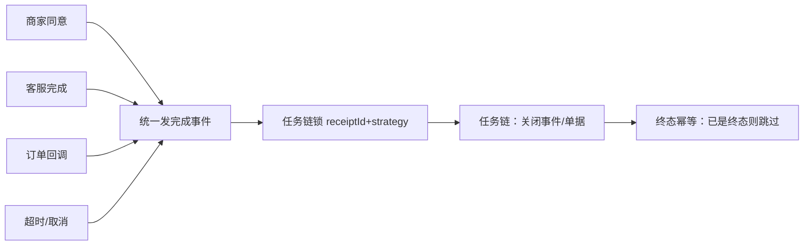
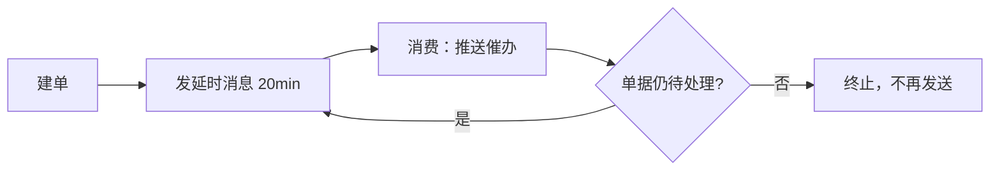

# 修改单项目 — 技术难点与实现方案

> 这份文档回答一个问题：**这个项目里哪些地方技术上不好做，用了什么方案解决的。**
> 每个难点固定六段：**难点是什么 → 为什么难 → 现有方案 → 设计取舍 → 遗留问题 → 面试怎么说**。
> 每节标注「归属」：平台既有 / 本项目实现。答辩时不要越界认领。

---

## 难点总览

| # | 难点 | 难度 | 归属 | 技术关键词 | 面试价值 |
|---|---|---|---|---|---|
| 1 | 多个写方同时改单据状态 | ★★★★ | 本项目接入 + 平台能力 | 单写入口、任务链、分布式锁 | 高 |
| 2 | 跨服务长事务的一致性 | ★★★★ | 本项目 | 顺序设计、补偿、最终一致 | 高 |
| 3 | 消息幂等与乱序 | ★★★ | 本项目 | 目标态比对、反查归属 | 高 |
| 4 | 并发的锁粒度选择 | ★★★ | 本项目 | 双层锁、锁键设计 | 中高 |
| 5 | 动态时效与超时驱动 | ★★★ | 本项目 | 截止时间函数、延时消息 | 中高 |
| 6 | 催办阶梯 | ★★★ | 本项目 | 延时消息自我续期 | 中高 |
| 7 | 异步化与事务边界的拉扯 | ★★★★ | 本项目 | 线程池隔离、ThreadLocal、sleep 妥协 | 高 |
| 8 | 11 个场景不写成一坨 if | ★★ | 本项目 | 策略模式、注册表 | 中 |
| 9 | 多值字段的存储与兼容 | ★★ | 本项目 | 位图 + diff 兜底 | 中 |
| 10 | 双端单据映射与接管 | ★★★ | 平台 + 本项目 | 映射表、新建凭证而非改字段 | 中 |
| 11 | 多语言富文本日志 | ★★ | 本项目 | 模板 + mapping + 异步 | 低 |
| 12 | 异步链路可观测 | ★★★ | 本项目 | 上下文透传、tag、trace | 中高 |
| 13 | 工程化前置（契约/多语言/规格） | ★★ | 本项目实践 | 脚本化校验、spec-first | 中（差异点） |

**一句话结论**：这个项目难的不是"写业务逻辑"，而是**在没有分布式事务、没有状态机引擎、消息只保证至少一次的前提下，把一张单据的十余个状态、四个写方、六类消息，收敛到一条可预期的轨道上。**

---

## 难点一：多个写方同时改单据状态

**归属**：写入口收敛是平台能力，修改单是接入方；幂等与顺序是本项目实现。

### 难点是什么

同一张修改单，可能被这些角色同时推动：

- 商家在租车宝点"同意"；
- 客服在工作台点"处理完成"；
- 订单服务发回"修改成功/失败"消息；
- 超时消费者触发"自动拒绝"；
- 订单被取消，触发"批量作废"；
- 客服点"接管"，单据换主体。

任何一个写方直接 `update status = ...`，都会出现三类事故：**覆盖**（后写的把先写的冲掉）、**非法跃迁**（已完成又被改回处理中）、**重复关单**（同一张单关了两次，任务单重复完成）。

### 为什么难

- 状态不是单一字段，而是三套（操作单主状态、申请单状态、明细 `display_status`），要同时保持一致；
- 写方在不同进程（SOA 调用、QMQ 消费、定时任务），没有共享内存，只能靠数据库和锁；
- 业务上没有"幂等键"这种天然唯一约束（同一订单可以有多次修改）。

### 现有方案：单写入口 + 双层锁 + 终态比对



三件事配合：

1. **单写入口**：所有写方都不直接改状态，而是发一个"完成事件"命令，由任务链统一关闭事件与单据。业务代码只负责"发命令 + 落业务表"。
2. **执行锁**：任务链执行前加 `receipt_strategy_execute_{receiptId}_{strategy}` 的分布式锁，抢不到直接失败（由 MQ 重试），保证同一张单同一类操作串行。
3. **终态幂等**：回调侧比对目标态（21 成功 / 13 失败），已经是目标态就丢弃，防止重复消息重复关单。

### 设计取舍

| 选择 | 好处 | 代价 |
|---|---|---|
| 用任务链做唯一写入口 | 状态变更集中、可审计、新增操作只加命令 | 链路长、理解成本高、调试要跨多个类 |
| 锁不等待，抢不到直接失败 | 不堆积线程、快速失败 | 依赖 MQ 重试，SOA 同步调用时用户会看到失败 |
| 终态比对而不是状态机引擎 | 实现简单、无额外框架 | 非法跃迁靠代码约定，没有编译期或运行期校验 |

### 遗留问题

- 没有真正意义上的状态机（没有跃迁表/DSL），非法跃迁只能靠代码自觉；
- 三套状态之间没有对账任务，长期存在漂移风险；
- 锁没有续期机制，任务链执行超时（>锁 TTL）时理论上可能被第二个请求插入。

### 面试怎么说

> "难点是同一张单据有 6 个写方。我们的做法是收敛写入口：业务只发完成事件，由任务链统一关单，再配一张单据级的分布式锁和终态幂等。这样把'多处 update 状态'变成'一处状态流转 + 多个幂等的事件源'。"

---

## 难点二：跨服务长事务的一致性

**归属**：本项目设计。

### 难点是什么

一次修改涉及三个服务：单据服务建单、订单服务改订单、资金服务收退款。整个流程可能持续几小时（等审批、等支付），**没有任何分布式事务框架**（不用 TCC、不用 Seata、不用 Saga 编排器）。

### 为什么难

- 时间跨度长，不可能长时间持有事务或锁；
- 各方都可能失败：建单失败、订单改失败、退款失败；
- 每一步都需要"可重入"，因为消息可能重复；
- 用户可见的中间态必须正确（不能出现"单据存在但订单没改"）。

### 现有方案：顺序设计 + 补偿回退 + 结果覆盖

| 环节 | 方案 | 为什么 |
|---|---|---|
| 自动生效场景 | **先调订单，成功才建单** | 订单失败就不产生单据，用"不建单"作为兜底，避免用户看到永远不会生效的单据 |
| 规则外场景 | 先建单，商家同意后再调订单 | 审批本身需要一张单承载，无法倒置 |
| 订单执行失败 | 单据回退"客服处理中"，不取消 | 失败原因多为可修复（库存被抢、价格变动），回退比重建成本低 |
| 金额 | 询价预估值 → 执行返回值 → 回调终值，逐次覆盖 | 以最权威、最后到的为准 |
| 订单取消 | 批量作废在途单据 | 防止处理一张已不存在订单的单据 |

### 设计取舍

两个方向都有人用，这里选了"订单优先"：

| 方案 | 失败后果 | 用户感知 |
|---|---|---|
| 先建单后调订单 | 孤儿单据（单据在、订单没改） | 用户看到进度但没生效，会投诉 |
| **先调订单后建单** | 孤儿变更（订单改了、单据没落库） | 用户看到成功，系统内部缺凭证，靠 receiptId 反查补救 |

**选择逻辑：宁可系统内部缺数据，也不要给用户看假进度。**

### 遗留问题

- "先调订单后落库"仍有孤儿变更窗口，目前**没有对账任务**；
- 没有本地消息表/事务消息，通知与日志依赖 `sleep` 等待落库；
- 退款是异步的，失败只能靠人工发现。

### 面试怎么说

> "我们没有引入分布式事务框架，而是用顺序设计把失败窗口压到最小：自动生效场景先调订单、成功才建单，用'不建单'当兜底。剩余的一致性靠幂等 + 补偿 + 最终一致，代价是极端情况会有孤儿变更，需要靠对账补。"

---

## 难点三：消息幂等与乱序

**归属**：本项目实现。

### 难点是什么

QMQ 是至少一次投递，意味着：同一消息可能重复；不同消息可能乱序（"修改成功"比"发起修改"先到）；某些消息缺少关键字段（提前还车的消息可能不带 receiptId）。

### 为什么难

- 没有全局唯一的消息 ID 可以拿来去重（业务侧也没建去重表）；
- 反查需要跨两张表（明细 → 申请单），且只能靠"最新一条"这种隐式规则；
- 消息到达时上游数据可能还没落库。

### 现有方案：三道过滤 + 反查 + 状态机兜底

1. **类型白名单**：只处理 `businessType ∈ {修改订单, 续租, 提前还车, 行程变更}`、`status ∈ {成功, 失败}`，其余直接丢弃。
2. **目标态比对**：`display_status` 已是 21（成功）/13（失败）就跳过——用状态本身当幂等键。
3. **缺失字段反查**：`receiptId` 为 0 时，按"订单 + 场景 6/7"查明细，再查申请单状态，按创建时间倒序取最新一条。
4. **等待落库**：消费前 `sleep(2s)`。

### 设计取舍

| 做法 | 优点 | 缺点 |
|---|---|---|
| 用状态当幂等键 | 零额外存储、天然幂等 | 只在"终态不可逆"时成立；中间态无法去重 |
| sleep 等落库 | 实现成本极低 | 依赖时序假设，压力大时失效 |
| 按最新一条反查 | 不改上游协议 | 依赖排序，历史数据多时可能取错 |

### 遗留问题

- 没有消息去重表，中间态消息（如"待支付"）重复消费仍可能重复发通知；
- `sleep(2s)` 是脆弱点，正解是事务消息或带退避的重试；
- 补款结果消费者当前被注释，链路上存在空洞。

### 面试怎么说

> "消息侧我们没建去重表，而是用状态机当幂等键——只有终态不可逆时这个前提成立，所以先保证状态设计成单向终态。缺字段的消息按订单+场景反查归属。这是成本最低的方案，但我知道它的边界：中间态去重做不了，sleep 等落库也不可靠。"

---

## 难点四：并发的锁粒度

**归属**：本项目选择，锁框架是平台提供。

### 难点是什么

同一个业务动作可能被并发触发：用户连点、App 与 IM 同时提交、客服和商家同时操作。锁太粗会误伤，锁太细会漏。

### 为什么难

锁键设计本质是**回答"什么算同一件事"**：

- 锁订单 → 同一订单的不同事（改时间 vs 改地点）被误挡；
- 锁用户 → 一个人多个订单互相阻塞；
- 锁全局 → 完全不可用。

### 现有方案：两层锁，各管一类并发

| 锁 | 键 | 拦截对象 | 失败行为 |
|---|---|---|---|
| 建单锁 | `订单 + 进线事件 + 动作` | 同一件事重复提交 | 直接返回「重复提交」 |
| 任务链锁 | `单据 + 策略` | 同一张单被两个写方同时推动 | 抛异常，交给 MQ 重试 |

**为什么是两层？** 第一层防"多生出一张单"，第二层防"同一张单被并发改"。两者作用对象不同，缺一不可。

实现细节：`tryLock` 拿不到立即返回（不阻塞等待）；`finally` 里无条件 unlock；锁 TTL 由框架控制（60s 量级）。

### 设计取舍

| 选择 | 理由 |
|---|---|
| 抢不到直接失败而非等待 | 避免线程堆积，把重试交给 MQ |
| 不用数据库唯一索引代替建单锁 | 同一订单允许有多次修改（历史单据），不能做唯一约束；可用"有效单据"部分唯一索引替代，但需要额外状态维护 |
| 锁 TTL 不续期 | 实现简单，任务链执行通常在一秒内 |

### 遗留问题

- 没有锁续期，长任务理论上会被插队；
- 部分唯一索引是更好的兜底（数据库层防重），目前只有应用层锁。

---

## 难点五：动态时效与超时驱动

**归属**：本项目实现。

### 难点是什么

"商家必须在什么时间前处理"不是固定值，而是**关于订单时间轴的函数**：

- 履约变更：`min{提交 + 2h, 新取车时间}`
- 提前还车规则外：`= 新还车时间`
- 无库存续租：`min{提交 + 12h, 还车时间}`
- 有库存类：1h 兜底（实际自动生效）

而且这个时间要同时写进 B 端单据（商家看到的截止时间）和驱动超时动作。

### 为什么难

- 规则随场景变化，且与订单时间强耦合；
- 超时后动作不同（拒绝 / 关闭 / 不退不补）；
- 必须"到点即触发"，不能靠人盯。

### 现有方案：独立的截止时间计算器 + 延时消息

1. 建单时调 `calculateDeadlineTime(场景, 流转时间, 取车时间, 还车时间)`，返回 `deadlineTime + timeoutSeconds`；
2. `deadlineTime` 写入 B 端单据的 `callTime`（商家看到的最晚处理时间）；
3. `timeoutSeconds` 用于发送延时消息，到点后消费端做状态校验再执行动作。

**为什么用延时消息而不是定时扫表：**

| 方案 | 优点 | 缺点 |
|---|---|---|
| 定时扫表 | 实现简单、可批量 | 扫描成本随数据量增长、精度受调度周期限制 |
| **延时消息** | 按单据维度、分钟级精度、天然分摊 | 消息量大，需要状态守卫防误触发 |

### 设计取舍与遗留

- 规则目前**硬编码在 switch 里**，文档宣称的 Qconfig 配置化并未实现——改规则要发版；
- 没有考虑时区与服务器时钟漂移（单据带 `localTimeZone`，但超时计算用本地时间）；
- 超时动作与业务语义强绑（拒绝/关闭），未来若新增动作需要改代码。

### 面试怎么说

> "时效不是固定值，而是关于取还车时间的函数：离取还车越近，商家窗口越短。我们把它抽成独立计算器，输出截止时间和超时秒数，前者写进商家单据，后者驱动延时消息。缺陷是规则还在代码里，没做成配置。"

---

## 难点六：催办阶梯（不用定时任务）

**归属**：本项目实现。

### 难点是什么

单据卡在商家侧时，要按固定间隔持续提醒（默认 20 分钟一轮），直到被处理；同时要防止对同一个商家无限骚扰。

### 为什么难

- 需要"每张单独立计时"，而不是全局定时；
- 需要自动停止（单据完成/取消后不能再提醒）；
- 需要节流（商家黑名单、用户催办次数上限）。

### 现有方案：延时消息自我续期

每次消息被消费 → 推送一次通知 → **再给自己发一条延时消息**，形成一条链。



三道闸门：

1. **状态守卫**：单据已完成/已取消直接跳过；修改单还要求处于"等待门店处理"子状态；
2. **商家黑名单**：按 vendorId 配置，命中不催；
3. **用户催办限次**：每条单据只允许用户催 1 次。

### 设计取舍

| 方案 | 优点 | 缺点 |
|---|---|---|
| 定时任务扫表 | 逻辑集中、易观测 | 扫描成本高、精度差、扩缩容麻烦 |
| **延时消息自我续期** | 按单维度精确、无扫表成本、天然停止 | 消息量随未处理单据线性增长；守卫失效会形成循环 |

### 遗留问题

- 没有"最大提醒次数"，完全依赖状态守卫终止；一旦状态异常（比如一直卡在中间态），会无限发消息；
- 建议改为指数退避 + 硬上限。

---

## 难点七：异步化与事务边界的拉扯（含 sleep 的真相）

**归属**：本项目实现。

### 难点是什么

建单链路要串 4–5 个远程调用（订单详情、投诉点、创建 B 单、写映射、通知任务单），同步做会让 RT 很长。所以大量使用异步。但异步就会遇到：**异步任务比事务提交更早执行，读不到刚写入的数据。**

### 为什么难

- 异步线程不在原事务里，可能读到旧数据；
- 线程池复用会带来 ThreadLocal 串数据（requestId、locale、orderId 全错）；
- 异步失败没有回滚，只能记日志。

### 现有方案

| 问题 | 方案 |
|---|---|
| RT 长 | 88 处 `CompletableFuture` 异步化（通知、日志、退款、附件） |
| 线程池抢占 | 统一走业务专用 DTP 线程池 `customerReceiptExecutor`，与其它业务隔离 |
| 上下文丢失 | SOA 响应 filter 里清理 `RequestContext`；异步任务内手动透传必要字段 |
| 读不到刚写入的数据 | **`sleep(1s)` 再发通知、`sleep(2s)` 再消费回调** |

### 关键说明：sleep 的本质

`sleep` 不是设计，是**对"异步早于事务提交"这个问题的临时绕过**：

- 建单后异步通知任务单，任务单可能立刻反查单据 → 读不到 → sleep 1 秒赌它落库了；
- 订单回调消费前 sleep 2 秒，赌订单侧写完了。

**正解**（也是面试可以讲的加分点）：

1. `TransactionSynchronizationManager.registerSynchronization` 的 `afterCommit` 回调；
2. 本地消息表 + 定时投递；
3. 消费端幂等 + 有条件重试，而不是盲目等待。

### 设计取舍

用 RT 换一致性：主链路只保留必须同步的调用，其余全部异步。代价是失败不可见、时序不可靠。

### 遗留问题

异步任务的 `catch` 基本只打日志，没有重试与告警；一旦异常，数据就静默丢了。

---

## 难点八：11 个场景不写成一坨 if

**归属**：本项目实现（策略框架是团队既有约定）。

### 难点是什么

11 个场景在"是否自动通过""调哪个订单接口""如何处理结果"上各不相同。如果写在建单方法里，就是一个几百行的 if-else 树，每次加场景都要改主干、容易改错。

### 现有方案：场景策略 + 注册表

每个场景一个类，实现同一接口，只回答三件事：

```
getModifyScene()      // 我是哪个场景
isAutoApprove()       // 我要不要人审
invoke(...)           // 我调哪个订单接口
```

启动时用 `@PostConstruct` 把注入的 List 转成 `Map<场景码, 策略>`；建单入口只做 `map.get(scene)`，取不到就报错。

**效果**：新增场景 = 加一个 `@Component` 类，主干零改动。修改单能在不改平台的前提下接进来，靠的就是这套扩展点（创建、完成、催办、接管、取消、转商 六个）。

### 设计取舍与风险

| 风险 | 说明 |
|---|---|
| 场景码重复注册 | `Collectors.toMap` 在 key 冲突时直接抛异常，启动失败（好事，早发现） |
| 策略类散落 | 11 个类分散在不同目录，新人难建立全貌，需要一张表（文档里的场景总表） |
| 策略只描述"是什么" | 真正的差异（超时规则）仍在另一个 switch 里，存在"两份真相" |

### 遗留问题

`ModifyDeadlineTimeExecutor` 里还有一份按场景的 switch，和策略类里的 `isAutoApprove` 是两处独立维护——**同一个场景的规则散在两个地方**，这是典型的可优化点。

---

## 难点九：多值字段的存储与兼容

**归属**：本项目实现。

### 难点是什么

一次修改可能同时改取车时间、还车地点、驾驶员。这些"改了哪几项"需要：能存、能查、能还原成具体字段、还要兼容老调用方只传粗粒度信息的情况。

### 现有方案：位图 + 组 bit + diff 兜底

| 层 | 做法 |
|---|---|
| 存储 | `modify_type` 一个 int：bit0 取车时间、bit1 取车地点、bit2 还车时间、bit3 还车地点、bit4 驾驶员组 |
| 查询 | `WHERE modify_type & 4 > 0` 直接筛"改过还车时间"的单 |
| 还原 | 位 → 业务字段枚举（如 bit0 → PICKUP_TIME） |
| 兼容 | 驾驶员组用 1 个 bit 聚合姓名/电话/年龄/证件；反向解析时用**修改前后字段 diff 取并集**兜底 |

**为什么驾驶员要合并成一个 bit？** 业务上"改驾驶员"就是一整组（人、电话、证件一起核对），拆开反而容易漏项；但前端可能只告诉你"改了驾驶员"，不告诉具体改了哪几个子字段，所以反向解析要靠 diff。

### 设计取舍

| 方案 | 优点 | 缺点 |
|---|---|---|
| 位图一列 | 省字段、查询快、组合简单 | 表达力有限（无法直接表达"只改了电话"） |
| 明细表一行一字段 | 表达力强、可扩展 | 行数膨胀、查询要聚合 |

### 遗留问题

位图的 bit 语义散落在两处（枚举 + 映射器），新增修改项需要同时改两处，容易漏。

---

## 难点十：双端单据映射与接管

**归属**：映射表与任务链是平台能力，修改单是接入方。

### 难点是什么

同一件事要同时存在于三个视角：用户的申请单、商家的操作单、客服的操作单。而且"当前有效的是哪一张"不是显式的，要靠状态和创建时间推断。

### 为什么难

- 一对一关系被打破（一张申请单可能先后挂过多张操作单：商家一张、客服接管后一张）；
- 状态要对齐：申请单的进度必须反映"当前生效的那张操作单"；
- 接管意味着"换一个主体继续办同一件事"。

### 现有方案

**映射表**：`申请单 ID ↔ 操作单 ID + 类型(B/O)`。
**接管**：收回商家单 → 新建客服单 → 写新映射 → 重开事件。

### 为什么接管不是"改处理人"

| 做法 | 审计 | 待办归属 | 可逆性 |
|---|---|---|---|
| 改字段 | 历史被覆盖，看不出谁审过 | 商家看板与客服工作台混在一起 | 退回要再改一次 |
| **新建凭证** | 两张单各自完整 | 各走各的待办队列 | 天然可逆 |

这是一个"用新凭证表达职责变更"的设计，和"用新记录表达状态变更"是同一个思路（事件溯源的味道）。

### 遗留问题

"取最新一条映射"依赖 `datachange_createtime` 倒序，属于隐式约定；如果同一时刻写入两张，排序不稳定。

---

## 难点十一：多语言富文本日志

**归属**：本项目实现。

### 难点是什么

每次修改都要往订单写一条人类可读的日志：`客服在 16:00 将取车时间从 A 改为 B`。要求中英文都有、变量要填、同一场景日志模板不同。

### 现有方案

- 模板存在多语言平台（Shark），按 key + 语言取；
- 变量用 `LogMappingBO` 列表填充（每个变量同时给中英文值）；
- 修改项名称与值分别从枚举和明细里取，拼成"变更内容"；
- 整段日志**异步**写回订单，不阻塞主流程。

### 取舍与遗留

模板与代码强耦合（key 硬编码在常量里），新增场景要同时改代码和语言平台；拼装逻辑散在多个 `saveOrderLogForXxx` 方法里，重复度高。

---

## 难点十二：异步链路的可观测

**归属**：本项目实现（CAT/日志框架是平台能力）。

### 难点是什么

一个请求进来，经过 SOA → 异步线程池 → QMQ 消费 → 下游 RPC，链路断成好几段。出问题时，日志里只有零散的记录，无法串起来。

### 现有方案

| 手段 | 作用 |
|---|---|
| `RequestContext`（ThreadLocal） | 请求级上下文：requestId、locale、orderId、uid |
| 日志 tag | 关键 ID 打 tag（requestId / orderId / receiptId / vendorId），便于检索 |
| SOA 请求/响应 filter | 入口建上下文，出口清理（防线程池串数据） |
| `@SOALog` | 统一记录出参入参与耗时 |

### 遗留问题

异步任务与 MQ 消费**不会自动继承** ThreadLocal，需要在任务里手动透传；一旦漏传，日志就断链。这也是业界为什么统一推 OpenTelemetry 这类自动埋点的原因。

---

## 难点十三（工程化，可选）：把联调成本前置

**归属**：本项目实践。

| 做法 | 解决的问题 |
|---|---|
| 契约抓取脚本（浏览器自动化拉契约平台，比对字段） | 联调前发现契约错配，而不是等到联调当天 |
| 多语言 key 巡检脚本（自动拉平台报错清单） | 漏翻译从"上线后事故"变成"提交前检查" |
| 规格先行（先写 spec / design / task / changelog 再写码） | 需求变更可追溯，AI 辅助开发有输入 |
| 代码标注需求号与任务号 | 事后能定位"这行为什么这么写" |

这几项不是架构难点，但在面试里是**差异点**：说明除了写业务，还在降低团队摩擦成本。

---

## 如果重做，我会优先改这六件事

| 优先级 | 改动 | 收益 |
|---|---|---|
| P0 | `sleep` 换成 `afterCommit` / 本地消息表 | 消除时序依赖，减少线上偶发"查不到数据" |
| P0 | 关键异步任务加重试与告警 | 异步失败不再静默 |
| P1 | 超时规则迁到配置中心 | 改规则不发版，与文档口径一致 |
| P1 | 增加单据状态对账任务 | 三套状态漂移可发现 |
| P2 | 建"有效单据"唯一索引 | 数据库层兜住应用层锁的漏洞 |
| P2 | 场景规则合并到一处（策略类内） | 消除"两份真相" |

---

## 面试速答（五问）

**Q1 这个项目最难的技术点是什么？**
> 多个写方并发改同一张单据的状态。解法是收敛写入口：业务只发完成事件，任务链统一关单，加单据级分布式锁和目标态幂等。

**Q2 没有分布式事务，怎么做一致性？**
> 用顺序设计压缩失败窗口：自动生效场景先调订单、成功才建单；其余靠幂等、补偿、最终一致。金额逐次覆盖、以最后到达的权威值为准。

**Q3 消息重复和乱序怎么处理？**
> 类型白名单 + 目标态比对当幂等键 + 缺单据号时按订单和场景反查。前提是把状态设计成单向终态。中间态去重目前没做，是已知短板。

**Q4 为什么用延时消息而不是定时任务？**
> 超时和催办都是"每张单独立计时"，延时消息按单维度、分钟级精度、无需扫表；配合状态守卫自动停止。风险是缺硬上限，守卫失效会循环。

**Q5 你怎么保证异步链路不出错？**
> 线程池隔离 + ThreadLocal 清理 + 关键 ID 打 tag。但我也知道现有实现只有 sleep 等落库、异常只打日志——这两点是我会优先改的。
